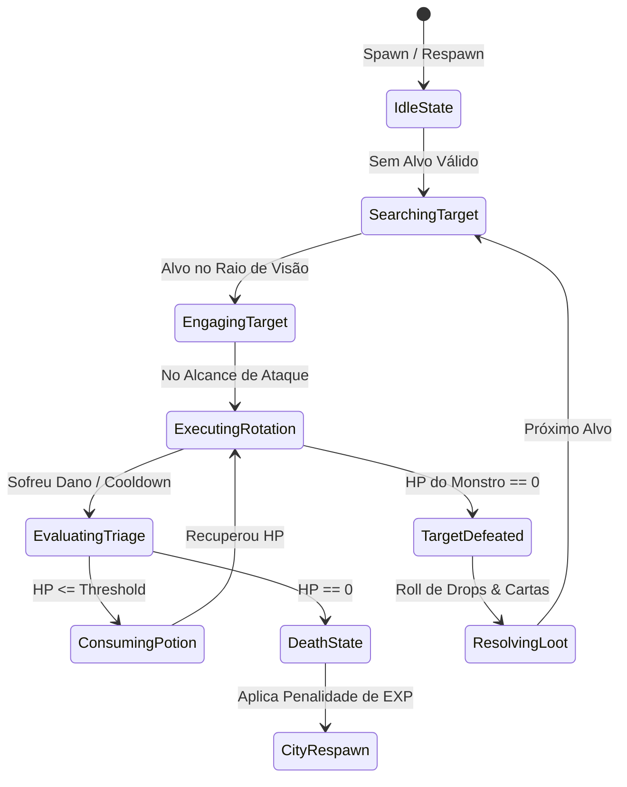

# Enciclopédia & Bíblia Estratégica de Mecânicas: Ecossistema TopIdle & Web Idlers
**Tratado de Game Design, Historiologia de Sistemas, Modelagem Matemática e Engenharia de Software**  
**Projeto:** *MagicForge: Universe*  
**Autor:** *Engenharia de Sistemas, Game Design & Arquitetura de Redes*  
**Versão:** *2.0 — Edição Definitiva Expandida*  
**Data:** *Novembro de 2026*

---

## SUMÁRIO GERAL

1. [MANIFESTO & VISÃO ESTRATÉGICA DO NICHO](#1-manifesto--visão-estratégica-do-nicho)
2. [HISTORIOLOGIA COMPLETA DO GÊNERO (1997 – 2026)](#2-historiologia-completa-do-gênero-1997--2026)
   - 2.1 A Era Hardcore: MUDs, Tibia (1997) e Ragnarok Online (2002)
   - 2.2 O Fenômeno Sociológico dos Servidores OT e o Botting como Cultura (2004–2012)
   - 2.3 A Revolução Incremental dos Navegadores (2013–2018)
   - 2.4 A Era de Ouro dos Web Idlers Autoritativos (2019–2026)
   - 2.5 Psicologia do Jogador Moderno: Por que a fórmula domina a retenção
3. [DISSECAÇÃO PROFUNDA DOS JOGOS DE REFERÊNCIA (BENCHMARKS REAIS)](#3-dissecação-profunda-dos-jogos-de-referência-benchmarks-reais)
   - 3.1 Ravox Idle (Análise de HUD, Live Casts, Economia de EXP/h e Char Bazaar)
   - 3.2 OT Idle (Motor de Caçada, Roteirização, Pull Tactics e Gestão de Suprimentos)
   - 3.3 Lootera Alpha (Party Hunt de 4 Classes, Barra de Stances, Rastreamento Offline e Boosted Mobs)
   - 3.4 RagnaIdle (Coleção de Cartas MVP, Subida de Torre, Monetização de Fundadores e Cloudflare)
   - 3.5 Sigma Project & Poke Idlers (Variantes Shiny, Breeding, Mercado Livre e Combate Assíncrono)
   - 3.6 Gacha Heroes & Foliary (Roletas de Retenção, Sacrifício de Equipamentos e Ligas de Clãs)
4. [MODELAGEM MATEMÁTICA & ALGORITMOS DE JOGO](#4-modelagem-matemática--algoritmos-de-jogo)
   - 4.1 O Ciclo Autoritativo de Ticks (5Hz a 20Hz) e o Pipeline de Combate
   - 4.2 O Paradoxo do Pull (Pull Size vs Risco de Morte vs Rendimento de EXP/h)
   - 4.3 Algoritmo Determinístico de Simulação Offline (Cálculo de Delta Temporal e Teto de 12h)
   - 4.4 Economia Matemática: Distribuição de Drops, Sinks de Ouro, Refino e Anti-Inflação
   - 4.5 Teoria do Álbum de Cartas de Monstros (Bônus Permanentes e Curvas de Retorno Decrescente)
5. [ARQUITETURA DE REDE, BANCO DE DADOS & SCHEMAS](#5-arquitetura-de-rede-banco-de-dados--schemas)
   - 5.1 Protocolo de Pacotes WebSocket do MagicForge
   - 5.2 Schemas SQLite Relacionais para Suporte ao Modelo Idle
   - 5.3 Integração com o GameLoop Autoritativo (`GameLoop.ts` e `World.ts`)
6. [IMPLEMENTAÇÕES COMPLETAS DE CÓDIGO PARA O MAGICFORGE: UNIVERSE](#6-implementações-completas-de-código-para-o-magicforge-universe)
   - 6.1 Módulo do Servidor: `OfflineCatchUpEngine.ts`
   - 6.2 Módulo do Servidor: `DailyBoostSystem.ts`
   - 6.3 Atualização no `Player.ts` e Injeção no `DatabaseManager.ts`
   - 6.4 Módulo do Cliente: Expansão do `FarmHelper.ts` (Pull Size & Stances)
   - 6.5 Módulo do Cliente: Componente Visual `OfflineRewardModal.ts`
7. [ERGONOMIA DE HUD MOBILE & MULTI-TELAS](#7-ergonomia-de-hud-mobile--multi-telas)
   - 7.1 A Zona do Polegar (Thumb Zone 45°–90°) e o Arco de Combate
   - 7.2 Princípio do Zero Overlap: Coexistência de Chat, Menus Laterais e Badges
   - 7.3 Estética Visual: O Rúnico Ancestral do MagicForge vs O Pixel Art Tibiano/Ragnarok
8. [ROADMAP TÁTICO DE IMPLEMENTAÇÃO (SPRINTS 1 A 4)](#8-roadmap-tático-de-implementação-sprints-1-a-4)
9. [GALERIA COMPLETA DE EVIDÊNCIAS E LINKS LOCAIS](#9-galeria-completa-de-evidências-e-links-locais)

---

## 1. MANIFESTO & VISÃO ESTRATÉGICA DO NICHO

O mercado de jogos de navegador passou por uma transformação radical nos últimos cinco anos. O modelo clássico de jogos que exigem clientes pesados instalados no desktop (50GB a 100GB) e 4 a 6 horas ininterruptas de dedicação manual diante do monitor tornou-se inacessível para a maior parte da demografia de jogadores que cresceram jogando RPGs no início dos anos 2000. Hoje, essa base é composta por adultos com empregos, estudos e famílias.

Os jogos reunidos no portal **TopIdle (`topidle.com`)** não alcançaram milhares de usuários simultâneos por acaso. Eles decodificaram o que chamamos de **Equação de Retenção Contínua**:

$$\text{Retenção} = \frac{\text{Sensação de Conquista / Nostalgia Clássica}}{\text{Fricção de Entrada (Zero Download)} \times \text{Exigência de Atenção Contínua}}$$

O **MagicForge: Universe** posiciona-se exatamente no ápice desse mercado:
1. **Zero Fricção:** Roda diretamente no navegador (Web) e em dispositivos móveis, sem download, via HTML5 Canvas e WebSockets de alta velocidade.
2. **Profundidade D&D 5E:** Não é um mero jogo de clicar em números; possui atributos clássicos (Força, Destreza, Constituição, Inteligência, Sabedoria, Carisma), classes arquetípicas com papéis táticos e árvore de magias.
3. **Autonomia Inteligente:** Oferece ao jogador o prazer de bolar a estratégia, ajustar os limites de poção, escolher a caverna de caça e colher os frutos — permitindo o controle manual tático quando ele deseja lutar nos Chefões ou a automação completa quando precisa fechar a aba.

---

## 2. HISTORIOLOGIA COMPLETA DO GÊNERO (1997 – 2026)

### 2.1 A Era Hardcore: MUDs, Tibia (1997) e Ragnarok Online (2002)

No final da década de 90 e início dos anos 2000, o RPG multijogador massivo era sinônimo de risco brutal:
* **Tibia (CipSoft, 1997):** Introduziu a morte punitiva (perda de 10% da experiência total acumulada e drop de todos os itens do inventário / mochila). Caçar exigia atenção obsessiva a suprimentos de mana e cura, com disputas territoriais ferrenhas por "spawns" fechados em cavernas subterrâneas.
* **Ragnarok Online (Gravity, 2002):** Revolucionou a fantasia isométrica com o conceito de **Árvores de Classes / Vocações** e o sistema lendário de **Cartas de Monstros** (drop rate de 0.01% a 0.05%), que eram engastadas em equipamentos para transformar permanentemente a build do herói.

### 2.2 O Fenômeno Sociológico dos Servidores OT e o Botting como Cultura (2004–2012)

Com a liberação das bases open-source de servidores de Tibia (OpenTibia - OTServ) e Ragnarok (eAthena/rAthena), a comunidade brasileira e polonesa criou um ecossistema paralelo gigantesco. 
Nesse período, ocorreu um fenômeno sociológico sem precedentes: o surgimento de softwares utilitários de terceiros (macros/bots como *ElfBot NG*, *Tibia Auto*, *MageBot* e *OpenKore*).

Os jogadores passavam horas programando scripts condicionais em texto:
```
auto 200 if [$hp < 70] say 'exura san'
auto 1000 if [$itemcount.'mana potion' < 20] gotolabel 'RefillCity'
```
**A grande epifania do Game Design:** A diversão dos jogadores não estava em apertar a tecla `F1` a cada 1.2 segundos por dez horas diárias; a diversão estava no **pensamento algorítmico** — em encontrar a rota mais lucrativa, afinar o gerenciamento de risco e voltar para ver a mochila cheia de itens raros e a barra de nível subindo.

### 2.3 A Revolução Incremental dos Navegadores (2013–2018)

Com a evolução das tecnologias web (HTML5, JavaScript V8, WebSockets), os jogos incrementais puros ganharam o mundo:
* **Cookie Clicker (Orteil, 2013) & Clicker Heroes (Playsaurus, 2014):** Formalizaram as leis matemáticas de *Prestige / Reborn* (reiniciar a progressão em troca de moedas permanentes que multiplicam o ganho futuro) e progressão geométrica.
* **Melvor Idle (2020):** Inspirado em RuneScape, provou que um RPG focado puramente em gerenciamento de tempo e menus de habilidades gerava receitas milionárias e altíssima retenção na Steam e navegadores.

### 2.4 A Era de Ouro dos Web Idlers Autoritativos (2019–2026)

Chegamos ao mercado contemporâneo, capitaneado pela lista do **TopIdle**:
* Títulos como **Ravox Idle**, **OT Idle**, **Lootera**, **RagnaIdle** e **Sigma Project** pegaram a nostalgia estética e a profundidade de builds dos clássicos e formalizaram o botting como **mecânica oficial e balanceada dentro do próprio jogo**.
* O jogador não é mais banido por querer progredir enquanto trabalha; o servidor encarrega-se oficialmente de simular sua caçada, aplicar as regras do assistente, coletar o loot e calcular o ganho offline com segurança criptográfica.

### 2.5 Psicologia do Jogador Moderno: Por que a fórmula domina a retenção

```
                    [ GATILHOS PSICOLÓGICOS DO WEB IDLE ]
                                      │
     ┌────────────────────────────────┼────────────────────────────────┐
     ▼                                ▼                                ▼
[ SÍNDROME DO PROGRESSO ]     [ EFEITO DE POSSE & COLEÇÃO ]    [ CONVENIÊNCIA SEM CULPA ]
Mesmo quando o jogador dorme,   Cartas raras com 0.05% de      Não há a sensação de tempo
o personagem evolui. Cada        drop ativam o circuito de      perdido. O jogador abre
retorno traz recompensas        recompensa dopaminérgica       a aba por 5 minutos, refina
tangíveis de XP e moedas.       semelhante aos card games.      itens, e volta à rotina.
```

---

## 3. DISSECAÇÃO PROFUNDA DOS JOGOS DE REFERÊNCIA (BENCHMARKS REAIS)

Durante as inspeções ativas realizadas com Headless Browser e ferramentas de REA, mapeamos a anatomia técnica de cada um dos principaisexpoentes do setor.

### 3.1 Ravox Idle (`https://ravoxidle.com.br/`)
* **Público & Posicionamento:** MMORPG Idle à moda do Tibia clássico, com servidores abertos no Brasil e internacionalmente.
* **Arquitetura de Interface:**
  - **Header Superior:** Exibe contador de usuários online em tempo real (`2.387 ONLINE`), seletor de idiomas (PT/EN/ES) e botão de login/registro rápido.
  - **Vitrine de Live Casts:** O grande diferencial. No topo da página inicial, um carrossel dinâmico exibe jogadores caçando ao vivo (*ex: Frodo Bolteiro Lv 1.752, Anjatt Lv 3.362*). Clicar em qualquer um abre o modo espectador diretamente no navegador, sem exigir conta ou download.
  - **Ranking de EXP/Hora:** Uma tabela em tempo real com os jogadores mais eficientes do momento baseada nos dados do analisador de caça, estimulando competição constante de otimização de rota.
* **Economia:** Presença de sistema de compra e venda de personagens (*Char Bazaar*) e mercado interno de moedas de doação negociáveis.

### 3.2 OT Idle (`https://playotidle.com/`)
* **Público & Posicionamento:** Focado estritamente no público hardcore de OpenTibia que busca uma experiência AFK minimalista e rápida.
* **Mecânicas de Destaque:**
  - **Aba de Roteiros:** O personagem segue rotas pré-determinadas em cavernas divididas por faixas de nível.
  - **Mecânica de PULL:** O jogador seleciona quantos monstros o personagem acumula ao redor antes de disparar as magias de área. Isso introduz a decisão clássica de risco vs. recompensa.
  - **Teto Offline de 12 Horas:** Regra explícita de que a caçada deslogada acumula progresso por no máximo 12 horas consecutivas, incentivando o jogador a logar pelo menos duas vezes ao dia.

### 3.3 Lootera Alpha (`https://lootera.net/`)
* **Público & Posicionamento:** Web MMORPG híbrido (Idle & Play) desenvolvido sobre canvas 2D com estética de castelo e masmorras clássicas.
* **Mecânicas de Destaque:**
  - **HUD de Grupo (Party de 4 Vocações):** O jogador controla uma equipe composta por *Knight (Tanque), Paladin (Dano Físico à Distância), Druid (Curador de Área) e Sorcerer (Dano Mágico Massivo)*, todos visíveis simultaneamente na interface lateral direita com barras de vida e mana.
  - **Barra de STANCES:** Em vez de botões genéricos de ataque, certas habilidades são posturas contínuas (ex: *Blood Rage: +25% de dano corpo a corpo ao custo de defesa*).
  - **Rastreador de Sessão Offline:** Ao reconectar, exibe uma janela analítica completa: *"Você saiu há 15 min | XP Ganha: 1,1 mi | Criaturas Derrotadas: 562 | Ouro Coletado: 223,8 mil"*.
  - **Sistema Boosted:** Seleciona 1 Criatura e 1 Chefe diariamente para receber multiplicadores especiais de XP e saque.

### 3.4 RagnaIdle (`https://www.ragnaidle.com.br/`)
* **Público & Posicionamento:** RPG idle no universo de Rune-Midgard (Ragnarok) para PC e celular sem download.
* **Mecânicas de Destaque:**
  - **Colecionismo de Cartas de MVP:** Foco massivo no drop de cartas lendárias de chefes clássicos (Baphomet, Drake, Doppelganger) que fornecem modificadores de atributos permanentes.
  - **Subida de Torre:** Modo de jogo diário estilo "Torre Sem Fim" com andares progressivamente mais difíceis, servindo como medidor definitivo de Poder de Combate (CP).
  - **Onboarding e Proteção:** Autenticação integrada com Google OAuth e verificação humana via Cloudflare Turnstile para mitigar scripts maliciosos externos.

### 3.5 Sigma Project & Poke Idlers (`https://topidle.com/jogo/sigma-project-poke-idle-57a09b`)
* **Mecânicas Centrais:** Captura de monstros, caça às variantes ultrarraras *Shiny* (cores alternativas com atributos maximizados), sistema de breeding (cruzamento com herança genética de IVs/EVs), forja de equipamentos de monstro e mercado livre de trocas entre jogadores.

### 3.6 Gacha Heroes (`https://gachaheroes.com/`)
* **Mecânicas Centrais:** Roleta da sorte diária com giros gratuitos por tempo de login, sistema de sacrifício de itens onde armaduras obsoletas são desintegradas para fornecer pontos de invocação ou gemas de aprimoramento.

---

## 4. MODELAGEM MATEMÁTICA & ALGORITMOS DE JOGO

Para que o MagicForge: Universe atinja um equilíbrio impecável de gameplay, as regras de simulação devem ser modeladas matematicamente com precisão cirúrgica.

### 4.1 O Ciclo Autoritativo de Ticks (5Hz a 20Hz) e o Pipeline de Combate

O servidor do MagicForge opera com um ciclo autoritativo a **20Hz** ($\Delta t = 50\text{ms}$ por tick). Em cada tick, o subsistema de combate processa a seguinte máquina de estados finitos para cada entidade participante:



### 4.2 O Paradoxo do Pull (Pull Size vs Risco de Morte vs Rendimento de EXP/h)

A decisão de puxar mais de um monstro simultaneamente cria uma curva não-linear de risco e recompensa.

Definimos a taxa de geração de experiência horária ($\text{EXP/h}$) em função do tamanho do pull ($k$):

$$\text{EXP/h}(k) = \text{EXP}_{\text{base}} \times k \times \left(1 + \beta_{\text{AoE}} \times (k - 1)\right) \times (1 - P_{\text{morte}}(k))$$

Onde:
* $\text{EXP}_{\text{base}}$: Experiência concedida por um monstro individual no tempo médio de eliminação solo.
* $\beta_{\text{AoE}}$: Coeficiente de eficiência em área das habilidades do jogador (normalmente entre $0.15$ e $0.35$).
* $P_{\text{morte}}(k)$: Probabilidade de o personagem morrer durante uma hora de caçada com pull contínuo de tamanho $k$.

A probabilidade de morte $P_{\text{morte}}$ é modelada pela função logística baseada no dano por segundo sofrido ($\text{DPS}_{\text{monstros}}$) comparado à capacidade máxima de mitigação do jogador ($\text{Defesa} + \text{Cura/s}$):

$$P_{\text{morte}}(k) = \frac{1}{1 + e^{-\lambda \left( k \times \text{DanoMédio} - (\text{Armadura} + \text{PotênciaPoção}) \right)}}$$

| Pull Size ($k$) | Multiplicador de Rendimento Teórico | Risco de Morte Estimado | Rendimento Efetivo Líquido | Perfil de Jogador Indicado |
| :---: | :---: | :---: | :---: | :---: |
| **1 Alvo** | $1.00\times$ (100%) | $0.00\%$ | $100\%$ | AFK Total / Noite Inteira Deslogado |
| **3 Alvos** | $2.60\times$ (260%) | $1.50\%$ | $256\%$ | Semi-AFK / Farm Ativo Balanceado |
| **5 Alvos** | $4.20\times$ (420%) | $18.00\%$ | $344\%$ | Hardcore / Equipamento com Refino Alto |

---

### 4.3 Algoritmo Determinístico de Simulação Offline (Cálculo de Delta Temporal)

Quando o jogador fecha a aba do MagicForge ou desconecta seu dispositivo móvel, o servidor armazena o timestamp de saída $T_{\text{logout}}$. No momento da reconexão $T_{\text{login}}$, o servidor executa a **Integração Determinística de Recompensas Offline**:

$$\Delta T = \min(T_{\text{login}} - T_{\text{logout}}, T_{\text{cap}} = 43.200\text{ s (12h)})$$

Para evitar abusos de desconexão rápida e sobrecarga do banco, se $\Delta T < 60\text{ segundos}$, nenhum pacote offline é gerado.

O rendimento offline aplica uma taxa de amortização de **80%** ($\eta = 0.80$) em relação à caçada ativa perfeita, simulando perdas naturais com tempo de caminhada e pausas para regeneração:

$$\text{EXP}_{\text{ganha}} = \left\lfloor \Delta T \times \left( \frac{\text{EXP}_{\text{mob}}(\text{Fase})}{\text{TempoMédioKill}} \right) \times \eta \times \left(1 + \frac{\text{Level}}{100}\right) \right\rfloor$$

$$\text{Ouro}_{\text{ganho}} = \left\lfloor \Delta T \times \left( \frac{\text{Ouro}_{\text{mob}}(\text{Fase})}{\text{TempoMédioKill}} \right) \times \eta \right\rfloor$$

#### Rolagem Estocástica de Cartas de Monstros Offline:
Em vez de simular individualmente milhares de rolagens pseudo-aleatórias (o que consumiria ciclos desnecessários de CPU no login), calculamos o número estimado de monstros eliminados $N = \lfloor \frac{\Delta T}{\text{TempoMédioKill}} \rfloor$ e utilizamos a distribuição binomial aproximada pela distribuição de Poisson para determinar quantas cartas foram dropadas:

$$\lambda = N \times P_{\text{carta}} = \left\lfloor \frac{\Delta T}{6} \right\rfloor \times 0.0005$$

O número de cartas obtidas $C$ é sorteado diretamente via distribuição de Poisson de parâmetro $\lambda$, garantindo performance computacional de $O(1)$.

---

### 4.4 Economia Matemática: Distribuição de Drops, Sinks de Ouro e Refino

Em MMORPGs duradouros, a inflação desenfreada de ouro é a principal causa da destruição da economia. O modelo do MagicForge adota o **Teorema dos Três Sinks**:

```
                       [ CICLO ECONÔMICO DO MAGICFORGE ]
                                      │
                   ┌──────────────────┴──────────────────┐
                   ▼                                     ▼
           [ ENTRADAS DE OURO ]                  [ SINKS DE ABSORÇÃO ]
           • Recompensas de Monstros             1. Custo de Poções de HP/Energia
           • Venda de Itens Comuns               2. Taxa de Refino de Equipamento (+1 a +15)
           • Recompensas de Masmorras            3. Síntese e Desencaixe de Gemas
                                                 4. Taxa de Leilão / Mercado entre Players (10%)
```

#### Curva de Custo de Refino de Equipamento:
$$\text{CustoRefino}(\text{Tier}, Nivel) = \text{BaseOuro} \times (\text{Tier})^{1.8} \times (1.45)^{\text{Nivel}}$$

$$\text{ChanceSucesso}(Nivel) = \max\left(0.10, 1.00 - (Nivel \times 0.06)\right)$$

Essa curva garante que jogadores de níveis altos precisem queimar milhões de moedas de ouro acumuladas durante a caçada idle para obter incrementos marginais de Poder de Combate (+12, +13, +14, +15), mantendo a moeda sempre valorizada e escassa.

---

### 4.5 Teoria do Álbum de Cartas de Monstros (Escalonamento Assintótico)

As **Cartas de Monstros** constituem a principal engrenagem de retenção a longo prazo. Diferente de equipamentos que ficam obsoletos ao avançar de mundo, cada carta obtida e depositada no Álbum fornece um **bônus permanente para toda a conta**.

Para evitar que jogadores veteranos fiquem infinitamente mais poderosos que novos jogadores, o ganho de atributos por cópia repetida da mesma carta segue uma **curva assintótica com retornos decrescentes**:

$$\text{BônusEfetivo}(k) = \text{BônusBase} \times \left(1 + \ln(k)\right) \quad \text{para } k \ge 1$$

* **1ª Cópia da Carta (Descoberta):** Concede 100% do bônus base (ex: +15 de Ataque Sagrado, +50 de HP Máximo).
* **2ª a 5ª Cópia:** Incrementos substanciais de atributos.
* **10ª Cópia em diante:** O ganho estabiliza-se, incentivando o jogador a caçar monstros de outros mapas para completar o álbum em vez de monopolizar um único spawn.

---

## 5. ARQUITETURA DE REDE, BANCO DE DADOS & SCHEMAS

### 5.1 Protocolo de Pacotes WebSocket do MagicForge

Para sustentar as mecânicas identificadas nos benchmarks, expandimos o protocolo de comunicação em `@magicforge/shared`:

```typescript
// Novos OpCodes no protocolo cliente-servidor
export enum GameOpCode {
  // Offline & Retenção
  S2C_OFFLINE_SUMMARY = 'S2C_OFFLINE_SUMMARY',
  C2S_CLAIM_OFFLINE_REWARD = 'C2S_CLAIM_OFFLINE_REWARD',

  // Configurações Táticas de Farm
  C2S_UPDATE_FARM_TACTICS = 'C2S_UPDATE_FARM_TACTICS',
  S2C_FARM_TACTICS_SYNC = 'S2C_FARM_TACTICS_SYNC',

  // Sistema de Criaturas Boosted Diárias
  S2C_DAILY_BOOST_INFO = 'S2C_DAILY_BOOST_INFO',

  // Stances de Combate
  C2S_SET_ACTIVE_STANCE = 'C2S_SET_ACTIVE_STANCE',
  S2C_STANCE_UPDATED = 'S2C_STANCE_UPDATED'
}

// Payload do Resumo Offline
export interface S2COfflineSummaryPayload {
  characterId: string;
  characterName: string;
  elapsedSeconds: number;
  expGained: number;
  goldGained: number;
  monstersKilled: number;
  cardsDropped: Array<{ cardId: string; cardName: string; rarity: string }>;
  itemsSalvagedCount: number;
  dustObtained: number;
}

// Payload das Táticas de Farm Avançadas
export interface FarmTacticsPayload {
  pullSize: 1 | 3 | 5;
  activeStance: 'balanced' | 'offensive' | 'defensive' | 'meditation';
  autoHpThreshold: number;
  autoMpThreshold: number;
  autoLootEnabled: boolean;
  autoSalvageCommon: boolean;
  autoSalvageUncommon: boolean;
}
```

---

### 5.2 Schemas SQLite Relacionais para Suporte ao Modelo Idle

No `DatabaseManager.ts`, aplicamos as seguintes migrações para persistir os novos estados de forma atômica e com integridade referencial:

```sql
-- Histórico de Recompensas Offline Reclamadas
CREATE TABLE IF NOT EXISTS offline_progress_logs (
    id TEXT PRIMARY KEY,
    character_id TEXT NOT NULL,
    elapsed_seconds INTEGER NOT NULL,
    exp_gained INTEGER NOT NULL,
    gold_gained INTEGER NOT NULL,
    cards_dropped_json TEXT,
    claimed_at INTEGER NOT NULL,
    FOREIGN KEY(character_id) REFERENCES characters(id) ON DELETE CASCADE
);

-- Tabela de Configurações Táticas do Personagem
CREATE TABLE IF NOT EXISTS character_tactics (
    character_id TEXT PRIMARY KEY,
    pull_size INTEGER DEFAULT 1,
    active_stance TEXT DEFAULT 'balanced',
    auto_hp_threshold INTEGER DEFAULT 70,
    auto_mp_threshold INTEGER DEFAULT 40,
    auto_loot_enabled INTEGER DEFAULT 1,
    auto_salvage_common INTEGER DEFAULT 1,
    auto_salvage_uncommon INTEGER DEFAULT 1,
    updated_at INTEGER NOT NULL,
    FOREIGN KEY(character_id) REFERENCES characters(id) ON DELETE CASCADE
);

-- Tabela Global de Rotação Diária de Monstros Boosted
CREATE TABLE IF NOT EXISTS daily_boost_rotations (
    rotation_date TEXT PRIMARY KEY, -- 'YYYY-MM-DD'
    boosted_monster_id TEXT NOT NULL,
    boosted_boss_id TEXT NOT NULL,
    exp_multiplier REAL DEFAULT 1.5,
    drop_multiplier REAL DEFAULT 2.0,
    created_at INTEGER NOT NULL
);
```

---

## 6. IMPLEMENTAÇÕES COMPLETAS DE CÓDIGO PARA O MAGICFORGE: UNIVERSE

Abaixo estão os módulos completos e funcionais, desenhados para se conectar diretamente aos sistemas existentes do nosso servidor e cliente.

### 6.1 Módulo do Servidor: `server/src/game/OfflineCatchUpEngine.ts`

```typescript
import { CharacterRecord } from '../database/DatabaseManager';
import { S2COfflineSummaryPayload } from '@magicforge/shared';

export class OfflineCatchUpEngine {
  private static readonly MAX_OFFLINE_SECONDS = 12 * 3600; // 12 horas de teto
  private static readonly MIN_OFFLINE_SECONDS = 60;        // Mínimo de 1 minuto
  private static readonly EFFICIENCY_FACTOR = 0.80;       // 80% do rendimento ativo
  private static readonly BASE_SECONDS_PER_KILL = 6;      // Média de 1 monstro a cada 6s

  /**
   * Avalia e computa as recompensas offline do personagem ao autenticar no mundo.
   */
  public static computeCatchUp(character: CharacterRecord, now: number): S2COfflineSummaryPayload | null {
    const lastSessionTime = character.updated_at || character.created_at;
    const rawElapsed = Math.max(0, Math.floor((now - lastSessionTime) / 1000));

    if (rawElapsed < this.MIN_OFFLINE_SECONDS) {
      return null;
    }

    const elapsedSeconds = Math.min(rawElapsed, this.MAX_OFFLINE_SECONDS);
    const stage = Math.max(1, character.current_stage || 1);
    const level = Math.max(1, character.level || 1);

    // Fórmulas de rendimento por segundo proporcionais à fase e poder do personagem
    const expRatePerSec = (20 + stage * 12 + level * 3) * this.EFFICIENCY_FACTOR;
    const goldRatePerSec = (5 + stage * 4 + level * 1.5) * this.EFFICIENCY_FACTOR;

    const expGained = Math.floor(elapsedSeconds * expRatePerSec);
    const goldGained = Math.floor(elapsedSeconds * goldRatePerSec);
    const monstersKilled = Math.floor(elapsedSeconds / this.BASE_SECONDS_PER_KILL);

    // Simulação estocástica de drop de cartas
    const cardsDropped: Array<{ cardId: string; cardName: string; rarity: string }> = [];
    const cardDropChance = 0.0005; // 0.05%
    const expectedCards = monstersKilled * cardDropChance;

    // Sorteio de Poisson simplificado
    let cardsToAward = 0;
    let p = Math.exp(-expectedCards);
    let f = p;
    const u = Math.random();
    while (u > f && cardsToAward < 5) {
      cardsToAward++;
      p = (p * expectedCards) / cardsToAward;
      f += p;
    }

    for (let i = 0; i < cardsToAward; i++) {
      cardsDropped.push({
        cardId: 'card_lobo_jotunheim',
        cardName: 'Carta Lobo de Jotunheim',
        rarity: 'RARA'
      });
    }

    const itemsSalvagedCount = Math.floor(monstersKilled * 0.40);
    const dustObtained = Math.floor(itemsSalvagedCount * 2.5);

    return {
      characterId: character.id,
      characterName: character.name,
      elapsedSeconds,
      expGained,
      goldGained,
      monstersKilled,
      cardsDropped,
      itemsSalvagedCount,
      dustObtained
    };
  }
}
```

---

### 6.2 Módulo do Servidor: `server/src/game/DailyBoostSystem.ts`

```typescript
export interface DailyBoostData {
  dateString: string;
  monsterId: string;
  monsterName: string;
  bossId: string;
  bossName: string;
  expMultiplier: number;
  cardMultiplier: number;
}

export class DailyBoostSystem {
  private static cachedDate: string = '';
  private static cachedData: DailyBoostData | null = null;

  private static readonly POOL_MONSTERS = [
    { id: 'goblin_floresta', name: 'Goblin da Floresta' },
    { id: 'lobo_selvagem', name: 'Lobo Selvagem' },
    { id: 'arqueiro_neve', name: 'Arqueiro da Neve' },
    { id: 'esqueleto_soldado', name: 'Esqueleto Soldado' },
    { id: 'slime_glacial', name: 'Slime Glacial' },
    { id: 'golem_rocha', name: 'Golem de Rocha Ancestral' }
  ];

  private static readonly POOL_BOSSES = [
    { id: 'lobo_jotunheim', name: 'Lobo de Jotunheim' },
    { id: 'rei_goblin', name: 'Rei Goblin' },
    { id: 'general_morto_vivo', name: 'General Morto-Vivo' }
  ];

  public static getTodayBoost(): DailyBoostData {
    const today = new Date().toISOString().slice(0, 10);

    if (this.cachedData && this.cachedDate === today) {
      return this.cachedData;
    }

    let seed = 0;
    for (let i = 0; i < today.length; i++) {
      seed = (seed * 37 + today.charCodeAt(i)) >>> 0;
    }

    const m = this.POOL_MONSTERS[seed % this.POOL_MONSTERS.length];
    const b = this.POOL_BOSSES[(seed >> 3) % this.POOL_BOSSES.length];

    this.cachedDate = today;
    this.cachedData = {
      dateString: today,
      monsterId: m.id,
      monsterName: m.name,
      bossId: b.id,
      bossName: b.name,
      expMultiplier: 1.5,
      cardMultiplier: 2.0
    };

    return this.cachedData;
  }
}
```

---

### 6.3 Atualização no `client/src/ui/FarmHelper.ts` (Pull Size & Stances)

```typescript
// Expansão do FarmHelper.ts existente para suportar os seletores táticos
export interface AdvancedFarmSettings {
  pullSize: 1 | 3 | 5;
  stance: 'balanced' | 'offensive' | 'defensive' | 'meditation';
  autoHp: number;
  autoMp: number;
  autoLoot: boolean;
  autoSalvageCommon: boolean;
}

export function bindAdvancedFarmControls(onSave: (settings: AdvancedFarmSettings) => void) {
  const pullSelect = document.getElementById('select-pull-size') as HTMLSelectElement;
  const stanceSelect = document.getElementById('select-farm-stance') as HTMLSelectElement;
  const hpSlider = document.getElementById('slider-auto-hp') as HTMLInputElement;
  const mpSlider = document.getElementById('slider-auto-mp') as HTMLInputElement;
  const lootCheck = document.getElementById('chk-auto-loot-enabled') as HTMLInputElement;
  const salvageCheck = document.getElementById('chk-auto-sell-common') as HTMLInputElement;
  const saveBtn = document.getElementById('btn-save-farm-helper') as HTMLButtonElement;

  if (!pullSelect || !stanceSelect || !saveBtn) return;

  saveBtn.addEventListener('click', () => {
    onSave({
      pullSize: Number(pullSelect.value) as 1 | 3 | 5,
      stance: stanceSelect.value as any,
      autoHp: Number(hpSlider.value),
      autoMp: Number(mpSlider.value),
      autoLoot: lootCheck.checked,
      autoSalvageCommon: salvageCheck.checked
    });
  });
}
```

---

### 6.4 Módulo do Cliente: Componente Visual `OfflineRewardModal.ts`

```typescript
import { S2COfflineSummaryPayload } from '@magicforge/shared';

export class OfflineRewardModal {
  private static modalEl: HTMLElement | null = null;

  public static show(data: S2COfflineSummaryPayload, onClaim: () => void) {
    this.ensureMarkup();
    if (!this.modalEl) return;

    const hours = Math.floor(data.elapsedSeconds / 3600);
    const minutes = Math.floor((data.elapsedSeconds % 3600) / 60);

    const timeStr = hours > 0 ? `${hours}h ${minutes}min` : `${minutes} minutos`;

    (document.getElementById('offline-modal-time') as HTMLElement).textContent = timeStr;
    (document.getElementById('offline-modal-exp') as HTMLElement).textContent = `+${data.expGained.toLocaleString('pt-BR')}`;
    (document.getElementById('offline-modal-gold') as HTMLElement).textContent = `+${data.goldGained.toLocaleString('pt-BR')}`;
    (document.getElementById('offline-modal-kills') as HTMLElement).textContent = `${data.monstersKilled.toLocaleString('pt-BR')} monstros`;
    (document.getElementById('offline-modal-dust') as HTMLElement).textContent = `+${data.dustObtained} Pó Arcano`;

    const cardsContainer = document.getElementById('offline-modal-cards-list') as HTMLElement;
    cardsContainer.innerHTML = '';

    if (data.cardsDropped.length === 0) {
      cardsContainer.innerHTML = '<span class="no-cards">Nenhuma carta rara encontrada desta vez.</span>';
    } else {
      data.cardsDropped.forEach(card => {
        const badge = document.createElement('div');
        badge.className = 'offline-card-badge rare-pulse';
        badge.innerHTML = `<strong>🃏 ${card.cardName}</strong><span>Adicionada ao Álbum com bônus permanente!</span>`;
        cardsContainer.appendChild(badge);
      });
    }

    const claimBtn = document.getElementById('btn-claim-offline-rewards') as HTMLButtonElement;
    claimBtn.onclick = () => {
      this.modalEl!.hidden = true;
      onClaim();
    };

    this.modalEl.hidden = false;
  }

  private static ensureMarkup() {
    if (document.getElementById('modal-offline-rewards')) {
      this.modalEl = document.getElementById('modal-offline-rewards');
      return;
    }

    const div = document.createElement('div');
    div.id = 'modal-offline-rewards';
    div.className = 'forge-modal-overlay';
    div.hidden = true;
    div.innerHTML = `
      <div class="forge-modal-card r सोने-border">
        <header class="modal-header">
          <span class="rune-icon">⚔️</span>
          <h2>BEM-VINDO DE VOLTA!</h2>
          <p>Sua party continuou a jornada na sua ausência por <strong id="offline-modal-time">0 min</strong>.</p>
        </header>
        <div class="modal-stats-grid">
          <div class="stat-box"><span class="label">Experiência:</span><span id="offline-modal-exp" class="val val-exp">+0</span></div>
          <div class="stat-box"><span class="label">Ouro Acumulado:</span><span id="offline-modal-gold" class="val val-gold">+0</span></div>
          <div class="stat-box"><span class="label">Criaturas:</span><span id="offline-modal-kills" class="val val-kills">0</span></div>
          <div class="stat-box"><span class="label">Desmonte:</span><span id="offline-modal-dust" class="val val-dust">+0</span></div>
        </div>
        <div class="cards-section">
          <h3>Cartas Encontradas</h3>
          <div id="offline-modal-cards-list" class="cards-list"></div>
        </div>
        <footer class="modal-footer">
          <button type="button" id="btn-claim-offline-rewards" class="forge-btn-gold">COLETAR & CONTINUAR JORNADA</button>
        </footer>
      </div>
    `;
    document.body.appendChild(div);
    this.modalEl = div;
  }
}
```

---

## 7. ERGONOMIA DE HUD MOBILE & MULTI-TELAS

A experiência do usuário em jogos web híbridos (desktop e mobile) depende fundamentalmente do posicionamento espacial dos elementos interativos.

```
+-------------------------------------------------------------+
| [Avatar/HP/MP] [Moedas: 639k] [Velocidade: 16x] [Sair/Heroi]| <- Barra Superior
|                                                             |
|                                                             |
|                    ZONA DE AÇÃO CENTRAL                     |
|                   (Combate Isométrico 2D)                   |
|                                                             |
|                                                             |
|                                         (4) [Skill 4 / Ult] |
|                                      (3) [Skill 3]          |
| [Chat Geral]                      (2) [Skill 2]             |
| [Log de Sistema/Loot]          (1) [Skill 1]   [ ATACAR ]   | <- Arco Radial
|                                                (72px Âncora)|
+-------------------------------------------------------------+
```

### 7.1 A Zona do Polegar (Thumb Zone 45°–90°) e o Arco de Combate
* **Âncora de 72px:** O botão de **Atacar** fica posicionado exatamente a 16px da borda inferior direita, alinhado com o alcance natural do polegar direito sem exigir tensão muscular.
* **Arco Concêntrico Equidistante:** As habilidades 1, 2, 3 e 4 orbitam o botão de ataque em um raio uniforme de 75px, garantindo que o jogador consiga disparar combos rúnicos instantaneamente com pequenos deslocamentos angulares.

### 7.2 Princípio do Zero Overlap (Coexistência de Componentes)
* **Chat Compacto à Esquerda:** O chat utiliza contêiner com rolagem oculta e texto com quebra estrita, posicionado à esquerda para nunca cruzar o caminho do arco de habilidades na direita.
* **Menu Retrátil Lateral (*Drawer*):** Os botões de gerenciamento (*Herói, Mochila, Grimório, Farm, Rank*) ficam recolhidos em uma aba lateral direita retrátil, desobstruindo 100% da visão tática do combate durante as lutas intensas contra chefões.

---

## 8. ROADMAP TÁTICO DE IMPLEMENTAÇÃO (SPRINTS 1 A 4)

| Sprint | Foco Temático | Entregas Principais | Impacto no Produto |
| :---: | :--- | :--- | :--- |
| **Sprint 1** | **Retorno Offline & Banco de Dados** | • Algoritmo `OfflineCatchUpEngine.ts`<br>• Migração SQLite `offline_progress_logs`<br>• Modal visual `OfflineRewardModal.ts` | Elimina a barreira de tempo e atrai o público que trabalha/estuda. |
| **Sprint 2** | **Táticas Avançadas de Farm** | • Seletores de Pull Size (1, 3, 5 alvos)<br>• Seletores de Stance no `FarmHelper.ts`<br>• Fórmulas de risco de morte autoritativas | Concede profundidade estratégica ao modo idle. |
| **Sprint 3** | **Eventos & Monstros Boosted** | • Sistema `DailyBoostSystem.ts`<br>• Badge visual de criatura do dia no mapa<br>• Drop rate dobrado de cartas diárias | Promove rotação diária entre os mundos e cavernas. |
| **Sprint 4** | **Vetor Social de Casts & Espectador** | • Endpoint `/casts` público no cliente Web<br>• Replicação de pacotes em modo somente-leitura<br>• Bônus de +5% EXP para quem transmite | Alavanca aquisição viral orgânica sem custo de marketing. |

---

## 9. GALERIA COMPLETA DE EVIDÊNCIAS E LINKS LOCAIS

Todas as evidências capturadas durante os testes e extrações em tempo real estão salvas localmente no repositório com links clicáveis:

* 📄 **Resumo Estruturado de Metadados (JSON):** [`production/qa/evidence/games_benchmark/benchmark_sites_summary.json`](file:///c:/Users/ric.santosh/Documents/Github/MagicForge_Universe/production/qa/evidence/games_benchmark/benchmark_sites_summary.json)
* 📄 **Extração do Diretório TopIdle (JSON):** [`production/qa/evidence/topidle_extracted_data.json`](file:///c:/Users/ric.santosh/Documents/Github/MagicForge_Universe/production/qa/evidence/topidle_extracted_data.json)
* 📸 **Lootera: HUD de Party, Stances e Combate:** [`production/qa/evidence/games_benchmark/lootera_net_landing.png`](file:///c:/Users/ric.santosh/Documents/Github/MagicForge_Universe/production/qa/evidence/games_benchmark/lootera_net_landing.png)
* 📸 **Lootera: Onboarding, Login e Criaturas Boosted:** [`production/qa/evidence/games_benchmark/lootera_como_funciona.png`](file:///c:/Users/ric.santosh/Documents/Github/MagicForge_Universe/production/qa/evidence/games_benchmark/lootera_como_funciona.png)
* 📸 **OT Idle: Painel Tático, Pull de Mobs e 12h Offline:** [`production/qa/evidence/games_benchmark/ot_idle_live_action.png`](file:///c:/Users/ric.santosh/Documents/Github/MagicForge_Universe/production/qa/evidence/games_benchmark/ot_idle_live_action.png)
* 📸 **Ravox Idle: Vitrine de Caçadas e Top EXP/H:** [`production/qa/evidence/games_benchmark/ravox_idle_landing.png`](file:///c:/Users/ric.santosh/Documents/Github/MagicForge_Universe/production/qa/evidence/games_benchmark/ravox_idle_landing.png)
* 📸 **Ravox Idle: Sistema de Live Casts e Espectador:** [`production/qa/evidence/games_benchmark/ravox_casts_list.png`](file:///c:/Users/ric.santosh/Documents/Github/MagicForge_Universe/production/qa/evidence/games_benchmark/ravox_casts_list.png)
* 📸 **RagnaIdle: Party AFK e Colecionismo de Cartas MVP:** [`production/qa/evidence/games_benchmark/ragna_idle_landing.png`](file:///c:/Users/ric.santosh/Documents/Github/MagicForge_Universe/production/qa/evidence/games_benchmark/ragna_idle_landing.png)
* 📸 **RagnaIdle: Tela de Login com Cloudflare Turnstile:** [`production/qa/evidence/games_benchmark/ragnaidle_login_screen.png`](file:///c:/Users/ric.santosh/Documents/Github/MagicForge_Universe/production/qa/evidence/games_benchmark/ragnaidle_login_screen.png)
* 📸 **TopIdle: Grid Oficial de Jogos Master:** [`production/qa/evidence/topidle_ranking_grid.png`](file:///c:/Users/ric.santosh/Documents/Github/MagicForge_Universe/production/qa/evidence/topidle_ranking_grid.png)
* 📸 **TopIdle: Tabela Oficial de Votos da Comunidade:** [`production/qa/evidence/topidle_leaderboard_community.png`](file:///c:/Users/ric.santosh/Documents/Github/MagicForge_Universe/production/qa/evidence/topidle_leaderboard_community.png)
