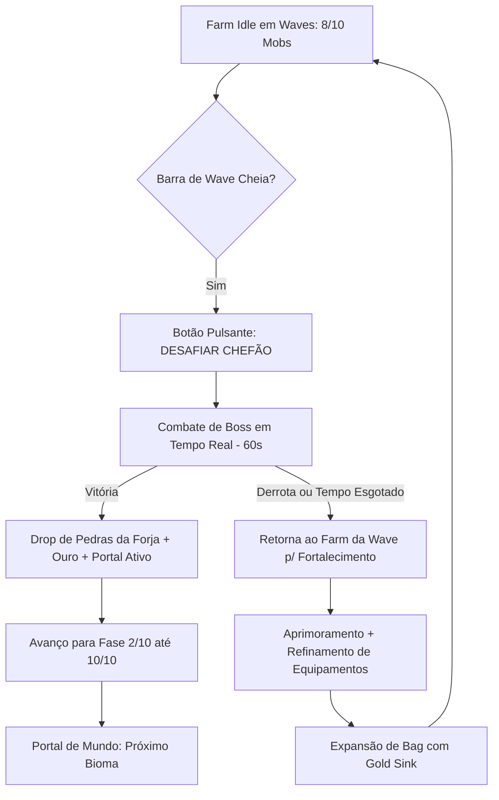

# 🌌 MagicForge: Universe — Arquitetura Mestre de MMORPG Idle

**Autor:** Antigravity (Arquiteto Sênior de MMORPG & Engenharia de Sistemas)  
**Versão:** 2.0.0 — Revisão Profissional de Mecânicas & Mercado  
**Referência de Mercado:** Ragnarok Idle Adventure, MU Origin, AFK Journey, Legend of Mushroom, MapleStory Idle  

---

## 🏛️ 1. Diagnóstico dos Benchmarks de Mercado (Idle MMORPG Loop)

Nos melhores jogos do gênero no mercado mobile e web, o engajamento de longo prazo apoia-se em quatro pilares fundamentais:



1. **O Loop de Waves & Boss:** O jogador nunca fica travado sem objetivo. Enquanto limpa a cota de monstros da fase, o botão **`💀 DESAFIAR CHEFÃO`** brilha. A luta do Boss tem limite de 60 segundos e testa se a build atual tem Dano por Segundo (DPS) e Sobrevivência suficientes.
2. **O Portal Rúnico Interdimensional:** Quando a fase é vencida, o portal brilha intensamente. Ao pisar ou clicar no portal, uma transição cinematográfica transporta o herói para o próximo cenário ou mundo (Mundo 1: Floresta da Forja -> Mundo 2: Picos Gelados de Jotunheim -> Mundo 3: Forja Vulcânica de Muspelheim).
3. **Economia de Gold Sink e Slots:** O inventário inicial (20 slots) rapidamente enche no farm contínuo. A expansão de novas linhas de 5 slots custa ouro escalonado (10k -> 50k -> 250k -> 1M -> 3M -> 10M), tornando o ouro uma das moedas mais cobiçadas e drenadas do jogo.
4. **Builds com Identidade Rígida (D&D 5e):** Guerreiro não usa cajado. Cada classe possui proficiência de armamento e armadura, com exigência de nível e atributos mínimos.

---

## 💎 2. Sistema de Aprimoramentos: Pedras, Refinamento, Gemas e Cartas

### 2.1. Como Funciona o Refinamento de Equipamentos (+1 a +15)
O refinamento é o núcleo de poder de qualquer item equipado (Arma, Armadura, Escudo, Elmo, Botas, Acessório):

| Nível de Refino | Item Necessário | Ouro Requerido | Chance de Sucesso | Efeito de Falha |
|---|---|---|---|---|
| **+1 a +3** | 1x `Pedra da Forja Comum` | 500 G | 100% | Nenhuma |
| **+4 a +6** | 2x `Pedra da Forja Comum` | 2.500 G | 85% | Nenhuma |
| **+7 a +9** | 3x `Pedra da Forja Rara` | 15.000 G | 60% | Mantém nível (+7) |
| **+10 a +12** | 2x `Pedra da Forja Mística` + 1x `Fragmento Rúnico` | 75.000 G | 40% | Regride 1 nível |
| **+13 a +15** | 5x `Pedra da Forja Mística` + 3x `Fragmento Rúnico` | 300.000 G | 20% | Regride 1 nível (Usa Amuleto de Proteção) |

### 2.2. Onde dropam os materiais?
- **Pedra da Forja (Comum):** Drop de monstros comuns (taxa de 15%) e **garantido ao Desmontar/Reciclar equipamentos comuns/incomuns na mochila**.
- **Pedra da Forja (Rara):** Drop garantido de Chefes de Fase e masmorras diárias.
- **Fragmento Rúnico Ancestral:** Drop exclusivo de Chefões de Mundo (Fase 10) e Eventos de Fim de Semana.
- **Pó Arcano:** Obtido ao excluir/reciclar itens mágicos da bag.

### 2.3. Gemas de Engaste (Sockets nos Equipamentos)
Cada equipamento raro ou superior possui de 1 a 3 cavidades (Sockets):
- 🔴 **Rubi Sangrento:** +8 a +35 de Força e +15 de Dano Físico.
- 🔵 **Safira das Marés:** +8 a +35 de Inteligência e +60 de Mana Máxima.
- 🟢 **Esmeralda do Vento:** +8 a +35 de Destreza e +3.5% de Taxa Crítica.
- 🟡 **Topázio Solar:** +8 a +35 de Constituição e +180 de HP Máximo.

---

## 💰 3. Economia de Inventário, Expansão e Despawn de Chão

### 3.1. Expansão de Slots da Mochila (Gold Sink Exponencial)
O jogador começa com **20 slots** (4 linhas de 5 slots). As próximas linhas são desbloqueadas com ouro:

```
Linha 5 (Slots 21-25):     10.000 G  [Atingível no Nível 15]
Linha 6 (Slots 26-30):     50.000 G  [Atingível no Nível 25]
Linha 7 (Slots 31-35):    250.000 G  [Atingível no Nível 35]
Linha 8 (Slots 36-40):  1.000.000 G  [Atingível no Nível 45]
Linha 9 (Slots 41-45):  3.500.000 G  [Atingível no Nível 55]
Linha 10 (Slots 46-50): 10.000.000 G [Endgame / Prestígio]
```

### 3.2. Regra de Chão e Bag Cheia
- Se a mochila estiver cheia e houver itens no chão, os drops possuem um tempo de vida autoritativo de **25 segundos** (`despawnSec: 25`).
- Após 25 segundos, o item evapora em partículas mágicas, impedindo o acúmulo de centenas de objetos e garantindo estabilidade e performance de rede a 20Hz.
- O jogador conta com o botão **`🗑️ Excluir`** e **`♻️ Reciclar`** dentro do inventário para desocupar espaço instantaneamente, transformando tralhas em Ouro e Pó Arcano.

---

## 🛡️ 4. Matriz de Classes, Requisitos e Builds (Sem "Guerreiro de Cajado")

| Classe | Armas Permitidas | Armaduras Permitidas | Atributo Primário | Estilo de Build |
|---|---|---|---|---|
| **Guerreiro** | Espadas 1H/2H, Machados, Escudos | Placas Pesadas, Malha | **FOR / CON** | *Juggernaut:* Alta defesa, contra-ataque e corte devastador. |
| **Bárbaro** | Montantes, Machados Duplos, Martelos | Malha, Couro Pesado | **FOR / CON** | *Berzerk:* Dano bruto massivo, furor e bônus em baixo HP. |
| **Mago** | Cajados Arcanos, Varinhas, Orbes | Mantos de Tecido, Seda | **INT / CON** | *Arcane Burst:* Explosão em área (AoE), crítico mágico e queimação. |
| **Bruxo** | Foices Arcanas, Varinhas do Caos, Cetros | Mantos Arcanos, Couro Leve | **CAR / INT** | *DoT / Maldição:* Dreno de vida, invocações e debuffs sombrios. |
| **Clérigo** | Maças Solares, Mangual, Escudos Sagrados | Malha Abençoada, Placas | **SAB / FOR** | *Paladino Sagrado:* Sustentação, cura contínua e punição divina. |
| **Arqueiro** | Arcos Longos, Bestas, Aljavas | Armaduras de Couro Ágil | **DEX / CON** | *Sniper Crítico:* Alcance máximo de 14m, alta velocidade e perfuração. |
| **Monge** | Manoplas Rúnicas, Bastões de Madeira, Faixas | Túnicas de Meditação, Sem Armadura | **DEX / SAB** | *Tempestade de Golpes:* Esquiva altíssima, combos velozes e atordoamento. |

---

## 📜 5. Lore Oficial: A Queda da Bigorna Astral

> *"Antes do primeiro bater de asas dos dragões cósmicos, existia a Bigorna Astral — a forja divina onde o Criador moldava as leis da física e da magia.  
> Na Guerra dos Titãs, a Bigorna se partiu em dez fragmentos celestiais que caíram através dos planos dimensionais, criando os Dez Mundos Rúnicos.  
> Cada mundo é protegido por um Guardião Colossal corrompido pela energia cósmica desgovernada. Apenas os heróis forjados que dominarem as armas do seu próprio arquétipo e atravessarem os Portais Rúnicos conseguirão reunir os fragmentos e restaurar a harmonia de MagicForge."*

---

## 👥 6. Arquitetura da Tela de Login e Seleção (3 Slots de Personagem)

```
[ TELA 1: SELEÇÃO DE SERVIDOR & CONTA ]
- Nome de Usuário / Conta (SQLite: accounts table)
- Seletor de Servidor:
  * [🟢 Servidor 1: Forja Ancestral] (Latência: 1ms • Recomendado)
  * [🟡 Servidor 2: Valhalla dos Titãs] (Cheio)
      |
      V
[ TELA 2: SALA DOS HERÓIS (3 SLOTS VISUAIS) ]
  ┌──────────────────┐  ┌──────────────────┐  ┌──────────────────┐
  │     SLOT 1       │  │     SLOT 2       │  │     SLOT 3       │
  │ [Guerreiro 3D]   │  │  [Vazio - Vago]  │  │  [Vazio - Vago]  │
  │ LordAventureiro  │  │                  │  │                  │
  │ Nv. 32 • Guerreiro│ │                  │  │                  │
  │ ⚔️ PC: 4.655     │  │                  │  │                  │
  │ [ JOGAR AGORA ]  │  │ [+ CRIAR HERÓI]  │  │ [+ CRIAR HERÓI]  │
  └──────────────────┘  └──────────────────┘  └──────────────────┘
```
