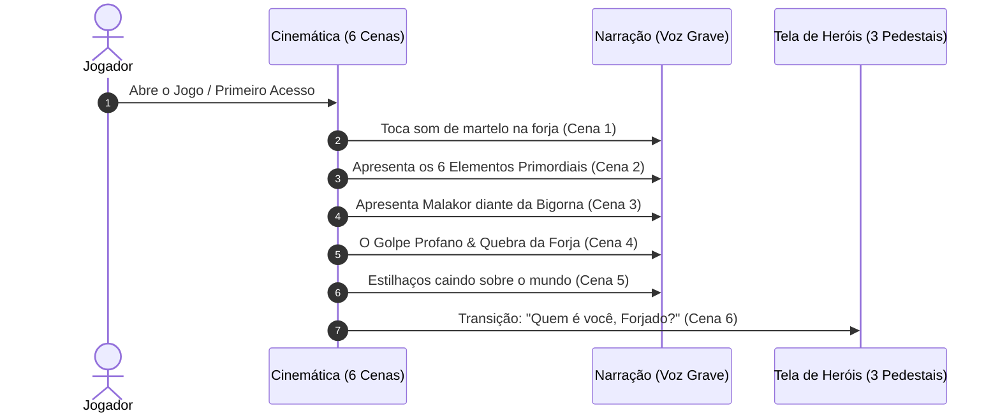
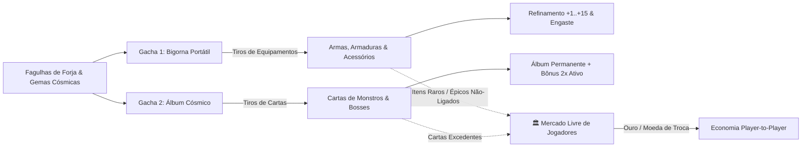

# 📖 Bíblia de Lore, Direção de Arte & Eventos — MagicForge: Universe

## 1. O Mito Fundador: A Ruptura da Bigorna Primordial (*The MagicForge*)

No centro do cosmos existia a **MagicForge**, a Bigorna Celestial onde os deuses moldaram a realidade utilizando os **6 Elementos Primordiais** (`Fogo`, `Água`, `Natureza`, `Terra`, `Luz` e `Sombra` — definidos em [`BaseStats.cs`](../MagicForgeClient/Assets/Scripts/Core/BaseStats.cs)).

### O Vilão Principal: Malakor, o Arquifalsário Cinzento

* **Quem é:** Antigo mestre-ferreiro mortal encarregado de guardar a Bigorna Celestial. Obcecado pelo poder absoluto (o "Combat Power Infinito"), Malakor tentou fundir todos os 6 Elementos em sua própria armadura de obsidiana.
* **O Cataclismo:** O golpe profano de seu martelo rachou a **MagicForge**. A explosão espalhou **Estilhaços de Forja (Relíquias e Equipamentos)** por todo o mundo e contaminou as criaturas da natureza com escória mágica.
* **Conexão com o Loop Idle / Auto-MMO:** Cada monstro abatido no mapa carrega "Fagulhas da Forja" em seu sangue. Quando o jogador deixa o herói no Auto-Combat, ele está extraindo essas fagulhas para forjar equipamentos no sistema de Gacha, elevar seu **Combat Power (CP)** e marchar rumo à Cratera de Malakor.

---

## 2. As 7 Classes ("Os Forjados") & Sincronização 100% (Unity ↔ Servidor 20Hz)

Cada herói é um **Forjado** cuja alma absorveu uma fagulha específica da Bigorna. Os valores base abaixo estão **100% sincronizados** entre o servidor autoritativo ([`shared/src/entities.ts`](../shared/src/entities.ts) e [`server/src/entities/Player.ts`](../server/src/entities/Player.ts)) e os ScriptableObjects do Unity (`MagicForgeClient/Assets/*.asset`):

| Classe | Asset Unity | Atributo Principal (`mainStat`) | Alcance (`attackRange`) | Intervalo (`attackIntervalSec`) | Velocidade (`baseSpeed`) | `STR` | `DEX` | `CON` | `INT` | `WIS` | `CHA` | HP Nv.1 (`CON*10+50`) | Dano Base Nv.1 (`Mod*3+5`) | CP Nv.1 |
| :--- | :--- | :--- | :---: | :---: | :---: | :---: | :---: | :---: | :---: | :---: | :---: | :---: | :---: | :---: |
| **Clérigo** | `Clerigo.asset` | Sabedoria (`WIS`) | `10.0m` (Ranged) | `1.5s` | `5.0` | 8 | 10 | 12 | 12 | **16** | 12 | **170** | **53** | **1150** |
| **Guerreiro** | `Guerreiro.asset` | Força + Carisma (`STR+CHA`) | `2.5m` (Melee) | `1.2s` | `5.0` | **15** | 10 | 14 | 8 | 10 | **13** | **190** | **89** | **1150** |
| **Bárbaro** | `Barbaro.asset` | Força (`STR`) | `2.5m` (Melee) | `1.4s` | `5.2` | **18** | 12 | 16 | 6 | 8 | 8 | **210** | **59** | **1120** |
| **Monge** | `Monge.asset` | Destreza (`DEX`) | `2.5m` (Melee) | `0.9s` | `5.5` | 12 | **16** | 12 | 8 | 14 | 8 | **170** | **53** | **1150** |
| **Bruxo** | `Bruxo.asset` | Carisma (`CHA`) | `10.0m` (Ranged) | `1.5s` | `5.0` | 8 | 10 | 10 | 12 | 10 | **18** | **150** | **59** | **1120** |
| **Mago** | `Mago.asset` | Inteligência (`INT`) | `10.0m` (Ranged) | `1.5s` | `5.0` | 6 | 10 | 10 | **18** | 12 | 10 | **150** | **59** | **1090** |
| **Arqueiro** | `Arqueiro.asset` | Destreza (`DEX`) | `12.0m` (Ranged) | `1.1s` | `5.2` | 10 | **18** | 12 | 10 | 10 | 8 | **170** | **59** | **1120** |

---

### Detalhamento Visual & Evoluções de Classe (Tier 1 ➔ Tier 2)

#### 1. Clérigo (`Clerigo.asset`)

* **Lore:** Canaliza a **Luz** e a **Natureza** que vazam das rachaduras da Forja.
* **Evolução A (Sacerdote Solar):** Foco em Luz pura, escudos de CP e dano radiante contínuo.
* **Evolução B (Druida Espinheiro):** Foco em Natureza, venenos passivos e invocação de raízes em área para farm AFK.

#### 2. Guerreiro (`Guerreiro.asset`)

* **Lore:** A vanguarda blindada com aço rúnico da Ordem da Bigorna. Combina força física (`STR`) à liderança inspiradora (`CHA`).
* **Evolução A (Paladino da Chama Branca):** Dano híbrido `STR + CHA` explosivo e cura ao golpear.
* **Evolução B (Cavaleiro Baluarte):** Conversão de `CON` (Constituição) em armadura refletora contra Bosses.

#### 3. Bárbaro (`Barbaro.asset`)

* **Lore:** Guerreiros tribais que beberam o magma líquido da MagicForge. Têm a maior Constituição inicial (`16 CON` = `210 HP`).
* **Evolução A (Berserker Cinzento):** Quanto menor a vida atual, maior a velocidade de ataque e crítico.
* **Evolução B (Senhor das Feras):** Absorve o espírito das bestas abatidas para ganhar roubo de vida brutal.

#### 4. Monge (`Monge.asset`)

* **Lore:** Ascetas que transformaram o próprio corpo em uma bigorna viva. Possuem o ataque mais rápido (`0.9s`) e a maior velocidade de movimento (`5.5`).
* **Evolução A (Mestre do Punho Celeste):** Combos ultra-rápidos que ignoram defesa.
* **Evolução B (Avatar do Chi):** Dispara ondas de choque de vento/água a cada 3 socos.

#### 5. Bruxo (`Bruxo.asset`)

* **Lore:** Estudiosos que firmaram pactos com entidades da **Sombra** aprisionadas sob a Forja para voltar o poder de Malakor contra ele mesmo.
* **Evolução A (Cultista do Abismo):** Maldições de dano contínuo (DoT) que derretem Bosses.
* **Evolução B (Invocador de Sombras):** Usa almas de monstros abatidos para invocar lacaios temporários no Auto-Combat.

#### 6. Mago (`Mago.asset`)

* **Lore:** Arquimagos que dominam a termodinâmica da Forja: o **Fogo** que derrete o metal e o **Gelo (Água)** que o tempera.
* **Evolução A (Piromante da Fornalha):** Explosões de dano crítico massivo em área.
* **Evolução B (Criomante Glacial):** Controle de grupo e lentidão nos monstros antes que encostem no herói.

#### 7. Arqueiro (`Arqueiro.asset`)

* **Lore:** Vigias das florestas cristalizadas com arcos encantados. Possuem o maior alcance do jogo (`12m`) e alta taxa de acerto crítico (`18 DEX`).
* **Evolução A (Franco-Atirador Rúnico):** Disparo letal à distância máxima.
* **Evolução B (Patrulheiro Elemental):** Chuva de flechas encantadas para limpeza rápida de hordas.

---

## 3. Bestiário do Ato I (Monstros de `World.ts`)

Todos os 5 monstros abaixo já estão ativos no servidor autoritativo ([`server/src/game/World.ts`](../server/src/game/World.ts)):

| Monstro | ID no Servidor | HP Máximo | Dano de Ataque | Posição de Spawn `(X, Y, Z)` | Papel no Game Design |
| :--- | :--- | :---: | :---: | :---: | :--- |
| **Slime da Floresta** | `mob_3` | `120` | `8` | `(10, 0, 12)` | Saco de pancadas inicial; engoliu cristais caídos da Forja. |
| **Goblin Lanceiro** | `mob_1` | `90` | `12` | `(-8, 0, 10)` | Inimigo equilibrado de patrulha com lança de ferro roubado. |
| **Lobo Selvagem** | `mob_4` | `100` | `14` | `(-14, 0, -10)` | Predador corrompido pela fumaça sombria; testa a `CON` do jogador. |
| **Goblin Arqueiro** | `mob_2` | `70` | `16` | `(12, 0, -8)` | "Glass cannon" inimigo: pouca vida, mas alto dano por disparo. |
| **Chefe Goblin** | `mob_5` | `350` | `28` | `(0, 0, 22)` | **Boss do Ato I (Gear Check):** Usa uma coroa de escória derretida de Malakor. |

### Galeria do Bestiário
* **Slime da Floresta:** 
* **Lobo Selvagem:** 
* **Goblin Lanceiro & Goblin Arqueiro:** 
* **Chefe Goblin (Boss):** 

---

## 4. Estrutura da Campanha: Início, Meio e Fim

1. **INÍCIO (Ato I — O Bosque dos Estilhaços | Níveis 1 a 30):**
   - O jogador desperta próximo às ruínas externas, aprende o funcionamento do Auto-Combat e descobre como seu atributo principal multiplica o `DanoBase` por 3.
   - **Clímax do Ato I:** Derrotar o **Chefe Goblin** (`HP 350`), desbloquear a **Bigorna Portátil (Gacha de Relíquias)** e escolher a **Evolução Tier 2** (`evolutionOptionA` ou `evolutionOptionB`).
2. **MEIO (Ato II — As Fornalhas Partidas | Níveis 30 a 70):**
   - Desbloqueio completo das fraquezas e resistências dos **6 Elementos** (`Fogo`, `Água`, `Natureza`, `Terra`, `Luz`, `Sombra`).
   - O jogador precisa ajustar os **4 Skill Slots** e farmar relíquias elementais específicas para vencer os Generais Elementais de Malakor.
3. **FIM & ENDGAME (Ato III — O Trono da Bigorna & Ascensão | Nível 70+):**
   - Invasão à Cratera da MagicForge e batalha contra **Malakor, o Arquifalsário Cinzento**.
   - **Loop Infinito (Prestige / "Reforjar a Alma"):** Após derrotar a forma física de Malakor, o jogador pode reforjar sua alma no fogo primordial para ganhar **Níveis de Ascensão** ou utilizar o **Reset de Classe Premium** mantendo suas Relíquias Míticas.

---

## 5. Eventos In-Game para Engajamento Idle/MMO

1. **Sobrecarga da Forja (Hora Feliz Elemental):** A cada 3 horas, a MagicForge emite um pulso de 1 dos 6 elementos por 30 minutos (+25% de Dano daquele elemento e +50% de Drop de Minério de Gacha).
2. **Invasão do Martelo Cinzento (World Boss):** Um Avatar de Malakor surge no centro do mapa `(0, 0, 0)` para todos os jogadores online atacarem juntos no Auto-Combat, com recompensa por ranking de DPS.
3. **Fenda da Bigorna (Torre de Provação AFK):** Ondas infinitas que recompensam builds equilibradas entre `CON` (Vida), `DEX` (Esquiva/Crítico) e Dano.
4. **Febre do Ouro Goblin:** Goblins Saqueadores Dourados correm pelo mapa por 5 minutos sem atacar, premiando builds de alta velocidade (`Monge`, `Arqueiro`, `Bárbaro`) ou controle de grupo (`Mago`).

---

## 6. Galeria Completa de Sprites Isométricas 2D de Gameplay (Top-Down 3/4, 45°)

> [!IMPORTANT]
> **100% Concluído e Integrado:** Todas as 15 sprites isométricas (7 classes, 5 monstros do `World.ts`, 1 vilão principal e 2 tilesets seamless de cenário) estão salvas e configuradas como `Sprite (2D and UI)` em `MagicForgeClient/Assets/Textures/Sprites/`, vinculadas no campo `isometricWorldSprite` dos 7 arquivos `.asset` e disponíveis em `client/public/assets/isometric/`.

### 6.1 Sprites Isométricas das 7 Classes (`isometricWorldSprite`)
| Classe | Arquivo em `Assets/Textures/Sprites/` | Preview Isométrico 3/4 (45°) |
| :--- | :--- | :---: |
| **Guerreiro** | `iso_hero_guerreiro.jpg` |  |
| **Clérigo** | `iso_hero_clerigo.jpg` |  |
| **Bárbaro** | `iso_hero_barbaro.jpg` |  |
| **Monge** | `iso_hero_monge.jpg` |  |
| **Bruxo** | `iso_hero_bruxo.jpg` |  |
| **Mago** | `iso_hero_mago.jpg` |  |
| **Arqueiro** | `iso_hero_arqueiro.jpg` |  |

### 6.2 Sprites Isométricas dos Monstros (`World.ts`) & Bosses
| Inimigo / Boss | Arquivo em `Assets/Textures/Sprites/` | Preview Isométrico 3/4 (45°) |
| :--- | :--- | :---: |
| **Goblin Lanceiro (`mob_1`)** | `iso_mob_goblin_lanceiro.jpg` |  |
| **Goblin Arqueiro (`mob_2`)** | `iso_mob_goblin_arqueiro.jpg` |  |
| **Slime da Floresta (`mob_3`)** | `iso_mob_slime_floresta.jpg` |  |
| **Lobo Selvagem (`mob_4`)** | `iso_mob_lobo_selvagem.jpg` |  |
| **Chefe Goblin (`mob_5`)** | `iso_boss_chefe_goblin.jpg` |  |
| **Malakor (Vilão Principal)** | `iso_boss_malakor.jpg` |  |

### 6.3 Tilesets Seamless de Chão (Arena & Floresta)
| Tileset | Arquivo em `Assets/Textures/Sprites/` | Preview Top-Down Ortográfico |
| :--- | :--- | :---: |
| **Piso de Pedra da Arena** | `tile_arena_stone.jpg` |  |
| **Grama de Fantasia** | `tile_fantasy_grass.jpg` |  |

---

## 7. Abertura Cinemática & Storytelling Inicial (Antes da Escolha de Personagem)

Para engajar o jogador e criar conteúdo para vídeos no YouTube, o jogo conta com uma introdução cinemática de 40 a 60 segundos com arte estática, efeito parallax (Ken Burns) e narração com voz grave. Pode ser pulada (*Skip*) a qualquer momento.

### Roteiro das 6 Cenas da Abertura:
* **Cena 1 — A Bigorna Primordial (Tela escura, som ritmado de marteladas pesadas no metal):**
  > *"Antes dos reinos, antes dos deuses terem nome, havia um som. Um martelo. Uma bigorna. E seis chamas que ainda não sabiam o que queriam ser."*
* **Cena 2 — Os 6 Elementos surgem um a um (Fogo, Água, Natureza, Terra, Luz, Sombra):**
  > *"Com elas, o mundo foi forjado. E alguém precisava guardar a forja."*
* **Cena 3 — Malakor, mortal, diante da MagicForge:**
  > *"Escolheram um homem. Um ferreiro. O melhor que já existiu... e o mais faminto."*
* **Cena 4 — O Golpe. Rachadura. Feixe de luz branca ofuscante:**
  > *"Malakor quis todas as chamas para si. Ergueu o martelo profano. E a Bigorna... quebrou."*
* **Cena 5 — Estilhaços caindo como estrelas cadentes sobre a floresta:**
  > *"Os estilhaços caíram sobre os planos dimensionais. Os monstros beberam a escória. E em algum lugar, uma alma acordou com uma fagulha que não era sua."*
* **Cena 6 — Transição épica para a Sala dos Pedestais:**
  > *"Quem é você, Forjado?"*

---

## 8. Tela de Seleção de Classe: Falas de Apresentação (Hover no Pedestal)

Ao passar o cursor ou tocar no pedestal de cada classe, uma fala de apresentação é reproduzida (áudio + balão dourado translúcido):

| Classe | Atributo Principal | Citação de Personalidade do Herói |
| :--- | :---: | :--- |
| **Guerreiro** | FOR / CHA | *"A Ordem da Bigorna caiu. Eu não. Meu escudo ainda sustenta o mundo."* |
| **Clérigo** | SAB | *"A luz sagrada vaza pelas rachaduras da forja. Alguém precisa costurá-las."* |
| **Bárbaro** | FOR / CON | *"Bebi o magma primordial. Ele ainda ruge e queima dentro das minhas veias."* |
| **Monge** | DEX | *"Meu corpo é a bigorna. Cada soco desferido, uma lição de equilíbrio."* |
| **Bruxo** | CHA | *"Ele quebrou o mundo. Eu só colhi o que sobrou... e o que sussurra debaixo do abismo."* |
| **Mago** | INT | *"O fogo derrete a matéria. O gelo a tempera. O resto é mero detalhe arcano."* |
| **Arqueiro** | DEX | *"A floresta virou cristal sob a fumaça de Malakor. Eu enxergo tudo de longe."* |

---

## 9. O Vilão Malakor: Personalidade, Falas de Mundo & Os 4 Encontros

Malakor não é um monstro histérico: seu tom é **calmo, paternal, cansado e sutilmente irônico**. Ele trata o herói não como um inimigo jurado, mas como um discípulo teimoso que não compreende a grandiosidade de sua obra.

### 9.1 Mensagens de Mundo (Chat Global & Texto Flutuante no Céu)
Disparam em marcos de nível ou eventos globais:
* **Nv. 5:** *"Mais um Forjado desperto. A Bigorna sempre escolhe os mais teimosos."*
* **Nv. 10:** *"Você mata slimes com orgulho. Pobres criaturas... elas só carregavam a escória que deixei cair."*
* **Nv. 20:** *"Continue forjando suas armas. Cada fagulha que você purifica é um fardo a menos para o meu martelo."*
* **Nv. 29 (Pré-Chefe):** *"O Chefe que você enfrenta usa uma coroa feita do meu primeiro erro. Seja compassivo."*
* **Primeira Morte do Jogador:** *"Isso... foi mais rápido do que eu esperava. Levante-se e tente de novo. A eternidade pode esperar."*
* **Retorno Offline (Idle Return):** *"Você descansou. O cosmos, não. A forja continua rachada, Forjado."*

### 9.2 Os 4 Encontros de Campanha com Malakor
1. **Ato I (Pós-Chefe Goblin — Fase 10/Mundo 1): A Projeção Espectral.**
   - Malakor surge como uma silhueta de fumaça cinzenta e aplaude pausadamente:
   > *"Impressionante. Ele era só um ladrão tolo com uma coroa quente. Mas você... você possui a têmpera certa."*
   *(Desaparece sem atacar, deixando o Portal Rúnico se acender).*
2. **Ato II (Meio do Mundo 2 — Picos Gelados): O Eco Menor (Mini-Boss com 10% de Força).**
   - Um reflexo de escória ataca o jogador em combate rápido. Ao ser derrotado, dissolve-se em cinzas com uma risada baixa:
   > *"Ótimo. Você aprendeu a quebrar uma sombra. Agora tente quebrar a bigorna viva."*
   *(Deixa um drop mítico garantido).*
3. **Ato II (Fim do Mundo 2 — Fase 10): O Fugitivo.**
   - Batalha intensa. Ao atingir 30% de HP, Malakor invoca um redemoinho vulcânico de fumaça e salta para a fenda:
   > *"Não fujo por medo, Forjado. Mas por conveniência. Nos vemos na Forja Primordial."*
4. **Ato III (Fase 10/Mundo 3 — A Cratera da MagicForge): O Trono dos 6 Elementos.**
   - Malakor empunha o Martelo Negro com os 6 Elementos cintilando na armadura de obsidiana.
   - **O Encerramento Narrativo do Loop Infinito (Prestige / Reborn):**
   Ao ser derrotado, a Bigorna não se conserta automaticamente — ela exige ser martelada novamente pelo próprio herói:
   > *"Você me venceu. Mas a Forja ainda clama por um ferreiro. Eu era apenas o martelo, Forjado... Quem segura o martelo agora é você."*
   *(Dispara o ritual de Transcendência Astral / Reborn I..IV, reiniciando o ciclo com +10 atributos e bônus permanentes).*

---

## 10. Bestiário Vivo: Falas Ambientais dos Monstros em Combate

Durante a batalha idle, monstros têm 10% de chance de emitir balões curtos de fala sobre suas cabeças, trazendo dinamismo e humor:

* **Slime da Floresta (`mob_3`):**
  - *"blub... brilhante... engoli... brilhante..."*
  - *"*(a fagulha cósmica pulsa dentro do gel translúcido como um coração assustado)*"*
* **Goblin Lanceiro (`mob_1`):**
  - *"A lança é minha! Eu achei! Foi a terra rachada que me deu!"*
  - *"O Grande Chefe avisou que você vinha! Disse que você é nanico!"*
* **Goblin Arqueiro (`mob_2`):**
  - *"Uma flecha só... na ponta do seu nariz!"*
  - *"Errei?! Não me olha assim, a fumaça entrou no meu olho!"*
* **Lobo Selvagem (`mob_4`):**
  - *"*(rosnado rouco — seus olhos fixam a fumaça de Malakor, não você)*"*
  - **Ao morrer:** *"*(a fumaça cinzenta escapa do focinho como um suspiro de alívio)*"*
* **Chefe Goblin (`mob_5` — Grimgor):**
  - **Entrada (100% HP):** *"EU SOU O REI DESTE BOSQUE! A COROA DE FOGO ME ESCOLHEU!"*
  - **Metade da Vida (50% HP):** *"A coroa... ela queima meu crânio... mas o poder é meu!"*
  - **Morte (0% HP):** *"Ele... ele prometeu que bastava segurar o fogo... só segurar..."* *(Planta a revelação de que os chefes são meras cobaias corrompidas por Malakor).*

---

## 11. NPCs Resgatados: Evolução do Hub & Desbloqueio de Sistemas

A cada mundo ou fase superada, um NPC é resgatado e passa a habitar o Altar Central, destravando funcionalidades do jogo:

| NPC Resgatado | Onde é Salvo | Sistema que Desbloqueia | Fala Emblemática |
| :--- | :---: | :---: | :--- |
| **Bria, a Aprendiz de Ferreira** | Pós-Chefe Mundo 1 (Bosque) | **Bigorna Portátil (Gacha de Equipamentos)** | *"Meu antigo mestre se chamava Malakor... Por favor, não conte a ninguém que eu disse isso."* |
| **Tobias, o Cartógrafo Cego** | Início do Mundo 2 (Jotunheim) | **Mapa Rúnico dos Portais (Fases 1 a 10)** | *"Não preciso de olhos para ver os mundos. A Forja canta através das fendas, cada portal em um tom."* |
| **Irmã Ysolde, a Arquivista** | Meio do Mundo 2 | **Grimório Rúnico (Skill Slots & Árvore D&D)** | *"As habilidades não são inventadas. São fragmentos de memórias dos deuses antes do cataclismo."* |
| **O Guardião Mudo (Golem)** | Fim do Mundo 2 | **Álbum Cósmico & Gacha de Cartas** | *(Permanece silencioso até o Ato III, onde sussurra uma única revelação crucial).* |
| **Bria (Revelação Endgame)** | Ato III (Cratera) | **Forja de Relíquias Ancestrais** | *"O martelo com que Malakor quebrou o cosmos... fui eu quem forjei para ele. Eu acreditava no sonho dele."* |

---

## 12. Arquitetura dos 2 Sistemas de Gacha & Economia de Mercado Livre

Para monetização sustentável e competição acirrada entre jogadores (*Rankings de CP e Torneios*), o sistema apoia-se em **2 Gachas Independentes** integrados a um **Mercado Livre (Auction House)**:

### 12.1 Gacha 1: Bigorna Portátil de Bria (Equipamentos & Relíquias)
* **Moeda:** Minérios Celestiais (dropados de Bosses e disponíveis via compra).
* **Pool de Recompensas:** Armas e Armaduras de tiers **Incomum (Verde)**, **Raro (Azul)**, **Épico (Roxo)** e **Ancestral (Dourado)** com stats D&D 5E sorteados.
* **Mecânica de Pity:** A cada 50 invocações, garantia de 1 item Épico da classe do jogador.
* **Comércio:** Equipamentos obtidos no Gacha sem refino são **"Desvinculados" (Tradable)** e podem ser vendidos no Mercado Livre por Ouro.

### 12.2 Gacha 2: Álbum Cósmico de Cartas (Atributos & Modificadores de Build)
* **Moeda:** Selos Rúnicos Arcanos.
* **Pool de Recompensas:** Cartas de Monstros (Slime, Goblin, Orc, Esqueleto) e Cartas Raras de Chefes (Grimgor, Frostbite, Ignis, Malakor).
* **Efeito:** Cartas duplicadas concedem **Fragmentos de Despertar** para subir estrelas (1★ a 5★) das cartas já possuídas no Álbum.
* **Comércio:** Cartas lacradas em pergaminhos podem ser comercializadas livremente entre jogadores.

---

## 13. Prompts de Dublagem & Vozes IA (ElevenLabs / Edge-TTS)

Para produção rápida de dublagens com máxima qualidade e consistência sonora:

### 1. Malakor, o Arquifalsário Cinzento
* **Voz / Estilo ElevenLabs:** *Deep, raspy, calm baritone, middle-aged male, slow cadence, slightly tired and philosophical, whisper of reverb.*
* **Prompt de Tom:** *"Speak as a legendary master blacksmith who broke the world not out of malice, but out of cold perfectionism. Never raise your voice. Treat the listener with gentle, condescending pity."*

### 2. O Narrador Cósmico (Abertura e Transições)
* **Voz / Estilo ElevenLabs:** *Epic documentary narrator, deep warm bass, ancient storyteller, echoing resonance.*
* **Prompt de Tom:** *"Solemn, mythic, deliberate pacing with dramatic pauses after mentions of the anvil and the hammer."*

### 3. Bria, a Aprendiz
* **Voz / Estilo ElevenLabs:** *Young female, 20s, nervous, skilled hands, carrying deep unspoken guilt.*
* **Prompt de Tom:** *"Soft-spoken, hesitant when mentioning Malakor, passionate and energetic when talking about metallurgy and forge hammers."*

---

## 14. Roteiro dos 6 Vídeos de Lore para o YouTube (3 a 5 Minutos)

1. **Episódio 1 — A Bigorna Quebrada:** A gênese do universo, o trabalho divino dos 6 elementos e o som da forja que regia o cosmos.
2. **Episódio 2 — Malakor, o Primeiro Ferreiro:** A biografia de Malakor, sua ascensão como guardião e a loucura da busca pelo poder absoluto.
3. **Episódio 3 — Os Sete Forjados:** Apresentação visual e filosófica de cada uma das 7 classes e a fagulha que cada herói herdou.
4. **Episódio 4 — A Tragédia do Rei Goblin:** A história comovente de Grimgor e a coroa incandescente que o escravizou.
5. **Episódio 5 — O Segredo de Bria:** As origens do martelo profano e as pistas escondidas no Altar Central.
6. **Episódio 6 — O Eco e o Trono:** O confronto final na cratera e a revelação de que reforjar o mundo é um dever perpétuo dos heróis.

