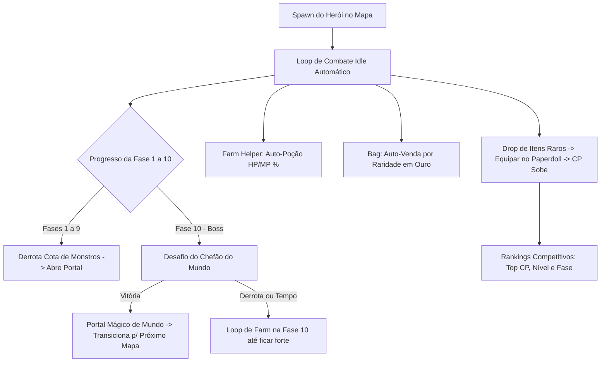

# 📱 Plano Mestre de Implementação: HUD Mobile Idle MMORPG, Fases, Equipamentos & Farm Helper

**Projeto:** MagicForge: Universe (Mobile & Web Auto-MMORPG)  
**Referência Visual:** Layout Stickman Go / Mobile Idle Wave RPG (Horizontal & Adaptativo)  
**Autor:** Antigravity (Engenheiro de Redes & Arquiteto de MMORPG Sênior)  
**Data:** Outubro de 2026  

---

## 🧭 1. Visão Geral da Transformação

Com a base autoritativa de rede (20Hz), persistência em SQLite, inventário de 20 slots, 28 magias D&D 5e e progressão de EXP/Níveis já consolidados, este plano estabelece o fechamento definitivo da **HUD Mobile**, do **Ciclo de Fases/Mundos com Portais**, da **Janela de Personagem (Paperdoll com manequim de equipamentos)**, do **Farm Helper Automático (Auto-Poção e Auto-Venda na Bag)** e do **Sistema de Rankings Competitivos**.

---

## 🖥️ 2. Arquitetura da Nova HUD (Inspirada no Stickman Go / Mobile Idle)

A interface será reestruturada para ter a elegância de jogos mobile de alto padrão, funcionando perfeitamente em telas de celulares horizontais e navegadores:

### 2.1. Canto Superior Esquerdo: Cartão de Status do Herói
* **Retrato Circular da Classe:** Borda dourada com a imagem artística da classe selecionada.
* **Badge de Nível:** Selo estilizado com o nível atual (ex: `Nv. 3`).
* **Barras de Status:**
  * Barra de HP com gradiente verde/vermelho e indicador numérico e de porcentagem (`1085 / 1130 (96%)`).
  * Barra de Energia / Mana azul/dourada (`100 / 100`).
* **Poder de Combate (CP) em Destaque Gigante:**
  * Tipografia dourada metálica com brilho e ícone de espadas cruzadas: `⚔️ CP 1.425` (como o `PC 10619437` da referência).
* **Título de Honra:** Badge como `[Cavaleiro Forjado]`, `[Guardião da Bigorna]`.

### 2.2. Canto Superior Direito: Mini-Mapa & Fase Atual
* **Localizador de Região:** Exibição estilizada da Zona e Fase atual (ex: `Floresta da Forja (1) [Fase 3/10]`).
* **Linha / Servidor:** `[Linha 1] • 20Hz • Ping: 1ms`.
* **Modo de Economia (Screen Saver):** Botão para reduzir consumo gráfico mantendo o farm idle ativo em segundo plano.

### 2.3. Centro Superior: Barra de Progresso da Fase & Desafio de Boss
* **Progresso da Wave:** Barra dourada de monstros abatidos na fase (ex: `Monstros: 8/10`).
* **Botão de Alerta de Boss (Fase 10):**
  * Quando atingir a Fase 10 ou quando a barra completar, exibe botão pulsante: `💀 DESAFIAR CHEFÃO`.
  * Se ativado o modo "Auto-Desafio", entra na batalha do Boss automaticamente.

### 2.4. Centro Inferior / Pop-up de Uso Rápido
* Ao dropar um item lendário, baú ou consumível importante, surge um pop-up flutuante temporário no canto direito com o ícone do item e o botão `Usar` ou `Equipar`, exatamente como o pop-up `Uso Rápido: Baú Material Aleatório` da imagem de referência.

### 2.5. Dock Inferior Mobile (Menu Principal de Navegação)
Barra com botões circulares táteis modernos:
1. 👤 **Personagem:** Abre a Janela de Equipamentos (Paperdoll) e Atributos D&D.
2. 🎒 **Mochila:** Abre os 20 slots de inventário e configurações do Farm Helper.
3. 📖 **Grimório:** Abre as 28 habilidades ativas e árvores de skills.
4. 🤖 **Farm Helper:** Painel de automação de poções e auto-venda.
5. 🏆 **Rankings:** Tabela de classificação (Top CP, Top Nível, Top Fases).
6. 🗺️ **Masmorras / Fases:** Visão geral dos mundos e fases desbloqueadas.

### 2.6. Rodapé da Tela: Barra Global de Experiência (EXP)
* Barra em gradiente ametista/ouro: `XP [Nv. 3] 246 / 823 (29.9%)`.

---

## 🥋 3. Janela de Personagem (Paperdoll & Atributos)

Atualmente os itens são equipados na mochila, mas faltava o **Manequim Visual de Equipamentos do Herói**.

### 3.1. Layout do Paperdoll
* **Centro da Tela:** Ilustração/Sprite animado do herói em pose de combate isométrica.
* **Slots de Equipamento ao Redor do Corpo:**
  * **Lado Esquerdo:**
    * 🧢 **Elmo / Cabeça** (`head`)
    * 🦺 **Peitoral / Armadura** (`chest`)
    * 👖 **Calça / Botas** (`legs`)
  * **Lado Direito:**
    * ⚔️ **Arma Principal** (`main_hand`)
    * 🛡️ **Escudo / Arma Secundária** (`off_hand`)
    * 💍 **Anel / Relíquia da Forja** (`relic`)
* Ao clicar em um slot equipado, exibe os detalhes do item com opção de `Desequipar`.
* Se o slot estiver vazio, exibe silhueta translúcida indicando o que pode ser colocado ali.

### 3.2. Painel de Atributos D&D 5e e Poder de Combate
Ao lado do manequim:
* **Combat Power (CP):** `⚔️ 1.425`
* **Vida Máxima (HP):** `1.130`
* **Dano Base:** `89`
* **Atributos D&D 5e:**
  * 🔴 **Força (STR):** Base + Bônus de Arma
  * 🟢 **Destreza (DEX):** Base + Bônus de Botas (Aumenta Chance de Crítico e Esquiva)
  * 🟠 **Constituição (CON):** Base + Bônus de Armadura (Aumenta HP Máximo)
  * 🔵 **Inteligência (INT):** Base + Bônus de Cajado/Tomo
  * 🟣 **Sabedoria (WIS):** Base + Bônus de Relíquias (Aumenta Poder de Cura)
  * 🟡 **Carisma (CHA):** Base + Bônus de Anéis

---

## 🗺️ 4. Sistema de Fases, Mundos & Portais Mágicos

### 4.1. Estrutura de Mundos e Fases
O jogo é estruturado em **Mundos**, cada um composto por **10 Fases progressivas**:

| Mundo | Nome do Mundo | Ambiente | Fases 1 a 9 | Fase 10 (Boss Stage) | Drops Exclusivos |
| :---: | :--- | :--- | :--- | :--- | :--- |
| **Mundo 1** | **Floresta da Forja** | Bosque verde com ruínas rúnicas | Slimes, Goblins Lanceiros e Arqueiros | **Chefe Goblin Gigante** | Espada de Ferro, Botas de Couro, Poções Menores |
| **Mundo 2** | **Minas de Mitril Cinzento** | Caverna de pedra escura e cristais | Morcegos de Pedra, Kobolds Mineiros | **Golias de Mitril Ancestral** | Armadura de Cota de Malha, Machado de Mitril |
| **Mundo 3** | **Planalto de Lava & Cinzas** | Solo vulcânico com fissuras de fogo | Elementais de Fogo, Cães Infernais | **Lorde Infernal Malakor (Avatar)** | Lâmina da Ruptura, Relíquia da Forja Antiga |

### 4.2. Mecânica de Transição de Fase (Portais Rúnicos)
1. **Fases Normais (1 a 9):**
   * Meta: Abater 10 monstros da wave atual.
   * Ao atingir a meta, surge um **Portal Rúnico Dourado** no canto superior direito do mapa (na direção para onde o herói caminha).
   * O herói entra no portal ou clica nele -> Efeito de transição de luz -> Inicia a próxima fase com monstros mais fortes e melhores recompensas de EXP/Ouro.
2. **Fase 10 (O Boss do Mundo):**
   * Surge o Chefão com barra de vida especial de Boss no topo da tela.
   * **Vitória:** O Boss é derrotado -> Dropa baú de recompensas épico/lendário -> Abre o **Grande Portal Interdimensional de Mundo** que leva ao próximo Mundo!
   * **Derrota / Time-Out:** Se o jogador não conseguir vencer o Boss, o herói continua em **Modo de Farm na Fase 10** (enfrentando monstros normais da fase) acumulando EXP, itens e ouro até estar forte o suficiente para tentar o Boss novamente.

---

## 🤖 5. Farm Helper (Assistente de Farm Idle & Mochila Inteligente)

Para proporcionar a melhor experiência de jogo Idle/Auto-MMO, o jogador terá controle total sobre o farm automático diretamente na interface:

### 5.1. Auto-Poção Inteligente (Configurável por Slider)
* **Auto-Poção de Vida (HP):**
  * Slider de 20% a 90% (Padrão: 60%).
  * Quando a vida do herói cair abaixo desse percentual, consome automaticamente uma `potion_hp_minor` ou `potion_hp_major` da mochila (com cooldown de 3 segundos entre poções).
* **Auto-Poção de Recurso (MP / Energia):**
  * Slider de 20% a 80% (Padrão: 40%).
  * Consome automaticamente poções de mana/energia quando necessário.

### 5.2. Auto-Venda Direta na Bag (Auto-Salvage)
Sem necessidade de ir a NPCs para esvaziar a mochila:
* **Filtros de Auto-Venda:**
  * `[x] Auto-vender itens COMUNS (Cinza)` -> Converte em 5-15 Ouro instantaneamente.
  * `[x] Auto-vender itens INCOMUNS (Verde)` -> Converte em 25-50 Ouro instantaneamente.
  * `[ ] Auto-vender itens RAROS (Azul)` -> Desmarcado por padrão para preservar equipamentos valiosos.
* Botão manual de emergência: `Vender Lixo da Bag` (vende todos os itens comuns e incomuns não equipados em 1 clique).

---

## 🏆 6. Sistema de Rankings Competitivos (Leaderboards)

Persistido no SQLite e consultável a qualquer momento pelos jogadores:

1. **Ranking de Poder de Combate (Top CP):**
   * Mostra os jogadores mais fortes do servidor (Classe, Nome, Nível, Guilda e CP Total).
2. **Ranking de Nível:**
   * Ordenado por Nível e EXP acumulada.
3. **Ranking de Fases / Masmorras (PVE Rush):**
   * Quem chegou ao mundo e fase mais distante (ex: `LordAventureiro - Mundo 3 / Fase 8`).
4. **Ranking de Abates (Kills):**
   * Quantidade total de monstros e chefes derrotados.
5. **Premiações do Top Rank:**
   * Distribuição de recompensas para o Top 1, Top 3 e Top 10 (Ouro, Títulos exclusivos no chat e Cristais da Forja).

---

## 📅 7. Cronograma de Execução Faseada

| Etapa | Foco Principal | Entregáveis |
| :---: | :--- | :--- |
| **Fase A** | **Nova HUD Mobile & Top Bar de Status** | Avatar com classe no topo esquerdo, HP/MP com %, Nível, CP grandão dourado, mini-mapa com fase atual e dock inferior com ícones circulares. |
| **Fase B** | **Janela de Personagem (Paperdoll)** | Manequim com os 6 slots de equipamento, vínculo direto com a mochila (clicou em equipar -> vai pro corpo do herói), exibição dos atributos D&D 5e e CP. |
| **Fase C** | **Farm Helper & Auto-Venda na Bag** | Sliders de Auto-Poção (% de HP e MP) e checkboxes de Auto-Venda por raridade na bag com conversão direta em Ouro. |
| **Fase D** | **Sistema de Fases 1 a 10 & Portais** | Contador de waves, surgimento do Portal Rúnico no canto direito, Chefão da Fase 10, transição de mundos e loop de farm em caso de falha. |
| **Fase E** | **Rankings Competitivos (Leaderboard)** | Tabela SQLite de ranking, modal com Top CP, Top Nível e Top Fases. |

---
*MagicForge: Universe — Forjado para a glória dos verdadeiros heróis.*
