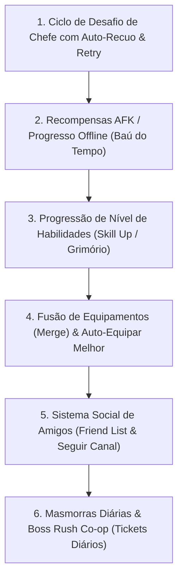

# 📜 MagicForge: Universe — Roadmap de Mecânicas Idle RPG & Registro de Progresso

> **Finalidade deste documento**: Servir como ponto único de verdade (Single Source of Truth) entre o usuário, Antigravity e Codex. Contém o que já foi entregue, o que está em andamento e a ordem exata das próximas mecânicas a serem implementadas. Se qualquer conversa for reiniciada ou compactada, este documento orienta a retomada imediata sem perda de contexto.

> **Atualização de direção — 03/11/2026:** a diretriz vigente é [Idle 100% automático](DIRETRIZ_IDLE_100_AUTOMATICO.md): movimento, ataque básico e avanço automáticos; conjuração AUTO/MANUAL opcional. Offline gratuito de 8h e política futura premium de 12h. Os números de testes e as descrições antigas abaixo são históricos. A Etapa 3 está implementada conforme [entrega do Grimório](ENTREGA_EVOLUCAO_HABILIDADES_2026-11-03.md); calibração econômica e comparação de investimentos contra chefes continuam pendentes.

---

> **Regra vigente — 11/11/2026:** [Expansão de bolsa e farm](EXPANSAO_BOLSA_E_FARM_2026-11-11.md). Removidos os requisitos de nível e Reborn da expansão. Ouro até 35 espaços; depois, Cash 100/200/400 ou ouro + 1 Selo de Expansão Astral, teto 50. Carteira e transação persistentes, sem concessão automática; loja/provedor e drop do selo pendentes. 309 testes de servidor e 30 de inventário aprovados. [Diagnóstico do Bárbaro](DIAGNOSTICO_BARBARO_IGNIS_2026-11-11.md) mantém regeneração 8/s; os valores históricos abaixo não substituem estas entregas. Trabalho atual na `master` local, ainda sem novo commit/push.

## 📌 Status Atual do Projeto
* **Data da Última Atualização**: 03/11/2026
* **Branch Principal**: `master` (100% sincronizado com `origin/master`)
* **Testes Automatizados**:
  - Servidor: 27/27 testes passando (100% autoritativo)
  - Cliente (Apresentação, Runic Layout, Party & AFK Modal): 37/37 testes passando (100%)
  - Build de Produção do Cliente (`vite build`): 100% OK

---

## ✅ 1. O que JÁ foi Entregue e Validado (Histórico Consolidado)

1. **Arquitetura de Servidor Autoritativo 20Hz**:
   - Loop estável de 50ms por tick, compensação de drift e AOI (Spatial Grid 20x20m).
   - Persistência robusta no SQLite (`magicforge.db`) com transações seguras.
2. **Sistema de Classes & Combate D&D 5E**:
   - 4 Classes base (Guerreiro, Clérigo, Bárbaro, Arqueiro) com atributos primários D&D (STR, DEX, CON, INT, WIS, CHA).
   - 4 Slots táticos com 3 escolhas de skills por slot (Truque, Nv 1, Nv 2, Nv 3).
   - Mecânicas reais: Bleed com ticks de dano, Stun, Quebra de Armadura, Escudo com Reflexão, Avatar da Guerra e Imunidade.
3. **Economia, Itens e Forja**:
   - Mochila expansível autoritativamente de 20 até 100 slots (`C2S_EXPAND_INVENTORY`).
   - Refino de equipamentos de +1 até +15 (`C2S_REFINE_EQUIPMENT`).
   - Soquetes de gemas em armas e armaduras (`C2S_SOCKET_GEM`).
   - Álbum de Cartas de Monstros com coleção passiva e encaixe de cartas ativas (`C2S_EQUIP_CARD`).
   - Automação FarmHelper com auto-potions e auto-salvage em massa de itens comuns/incomuns.
4. **Mundos, Fases e Preservação**:
   - Fases 1 a 10 no Mundo 1 (Floresta da Forja) e Mundo 2 (Picos de Jotunheim).
   - Spawn de Grimgor (Boss Mundo 1) e Frostbite (Boss Mundo 2).
   - Portal Rúnico com **preservação integral de progresso** (nível, EXP, ouro, inventário, equipamentos, gemas, cartas, loadout e Reborn).
5. **Multiplayer, Canais & Grupos (Party)**:
   - `WorldManager`: balanceamento automático e canais instanciados (Canal 1 e Canal 2 para cada mundo).
   - `PartyManager`: grupos de 2 a 4 jogadores, sincronização de HP/MP/Nível em tempo real, liderança (promover/expulsar/sair/desfazer).
   - EXP Cooperativa: bônus de proximidade de +10% de EXP por membro aliado a até 25m.
   - UI Web: HUD de Grupo (`PartyHUD.ts`) e Seletor de Canais (`ChannelSelector.ts`).
6. **Apresentação Rúnica & UI Visual (Merge com `fix/telas-bordas-cards`)**:
   - Molduras rúnicas esculpidas, SVG assets customizados, gaveta tática responsiva, docking de poções e pedestal de seleção de heróis.
7. **Ciclo de Desafio de Chefe com Auto-Recuo & Retry (Etapa 1)**:
   - Auto-recuo imediato para a Fase 9 com farm contínuo de mobs em caso de derrota/timeout.
   - Re-desafio manual com cura total e toggle de auto-challenge autoritativo.
8. **Recompensas AFK / Progresso Offline - Baú do Tempo (Etapa 2)**:
   - Cálculo autoritativo de Ouro e EXP acumulados com teto gratuito de 8 horas (premium de 12 horas reservado para o futuro) e limiar mínimo de 5 minutos.
   - Drops de suprimentos/minérios por tempo ausente e modal estético `[Coletar Recompensas Offline]`.

---

## 🧭 2. Ordem Sequencial das Novas Mecânicas Idle RPG

Esta é a ordem oficial de desenvolvimento para transformar o MagicForge em um Idle RPG de ponta (referência aos sucessos do *topidle.com* como *Legend of Slime*, *Blade Idle*, *AFK Arena* e *Slayer Legend*):

---

### ✅ ETAPA 1: Ciclo de Desafio de Chefe com Auto-Recuo & Retry *(CONCLUÍDO E VALIDADO)*
* **Problema resolvido**: Se o temporizador de 60s do Chefe expira ou o jogador morre na Fase 10, o jogo não pausa o farm nem trava a tela.
* **Comportamento Implementado e Testado**:
  1. **Auto-Recuo**: Falha na luta do Chefe (TIMEOUT ou DEATH) aciona recuo imediato para a **Fase 9**, onde monstros normais continuam spawnando e sendo abatidos automaticamente (ganho ininterrupto de Ouro e EXP). Jogadores mortos são revividos com 100% HP/MP no acampamento.
  2. **Botão de Re-desafio**: No HUD e na barra de fase, o botão **`[💀 DESAFIAR CHEFÃO (Fase 10)]`** fica disponível para acionamento manual imediato.
  3. **Toggle de Auto-Desafio (`autoChallengeBoss: ON/OFF`)**:
     - `OFF` (padrão): O jogador permanece no farm seguro da Fase 9 até decidir re-desafiar.
     - `ON`: Ao abater os monstros da Fase 9, o servidor re-desafia o Chefe e avança para a Fase 10 automaticamente.
  4. **Entrada na Arena do Chefe**: Ao desafiar, cura 100% de HP/MP, avança para a Fase 10, despawna monstros menores e invoca o Chefão do mundo com 60s no cronômetro.
* **Validação**: Testes automatizados em `server/tests/boss-challenge-cycle.test.ts` (4/4 passando).

---

### ✅ ETAPA 2: Recompensas AFK / Progresso Offline (Baú do Tempo) *(CONCLUÍDO E VALIDADO)*
* **Objetivo**: Recompensar o jogador pelo tempo que passou fora do jogo (celular bloqueado ou navegador fechado).
* **Mecânica Implementada e Testada**:
  - `last_logout` persistido e atualizado autoritativamente na tabela `characters` do SQLite.
  - Ao logar, se $\Delta t \ge 300\text{s}$ (5 minutos), gera `S2C_OFFLINE_REWARD_INFO` com teto gratuito de 8 horas ($28.800\text{s}$); premium futuro de 12 horas ainda não ativado.
  - Fórmulas autoritativas:
    - $\text{Ouro/s} = \text{Mundo} \times 15 + \text{Fase} \times 5 + \text{Nível} \times 3$
    - $\text{EXP/s} = \text{Mundo} \times 10 + \text{Fase} \times 4 + \text{Nível} \times 2$
    - Suprimentos/Minérios: Minério de ferro e poções concedidos a cada 15 min de ausência.
  - Resgate autoritativo (`C2S_CLAIM_OFFLINE_REWARDS`) com proteção contra double-claim.
  - Modal estético `OfflineRewardModal.ts` com filigrana rúnica no client web.
* **Validação**: 4 testes de backend em `server/tests/offline-rewards.test.ts` e teste de layout/duração em `client/tests/offline-rewards-ui.test.mjs`.

---

### ✅ ETAPA 3: Progressão de Nível de Habilidades (Skill Up / Grimório) *(IMPLEMENTADO; CUSTOS EM CALIBRAÇÃO)*
* **Objetivo**: Permitir que habilidades ativas e truques evoluam além do nível base.
* **Mecânica**:
  - Cada habilidade no Grimório pode subir de Nível 1 a Nível 20.
  - Custo de upgrade em ouro e Pó Arcano já disponível no farm e na reciclagem; pergaminhos não foram introduzidos nesta entrega.
  - Cada nível acrescenta 5% à potência base de dano, sangramento, cura ou escudo implementado, até +95% no nível 20. Cooldowns, recursos e durações permanecem iguais.
  - Persistência na tabela `character_skills` do SQLite.
  - Compra autoritativa e atômica: ouro, material e nível são gravados juntos. Pedido repetido com o mesmo nível esperado não cobra novamente.
  - Melhorias acompanham a habilidade ao trocar escolhas, reconectar e mudar de mundo; categorias, desbloqueios e ordem automática são preservados.
  - Habilidades de suporte sem efeito de potência implementado exibem evolução indisponível e não cobram recursos.
  - Economia inicial medida em 04/11/2026: primeira melhoria por 300 ouro + 1 Pó Arcano; previsão de tempo no Grimório e proteção de materiais na auto-venda. Ver [entrega e limitações](ENTREGA_ECONOMIA_2026-11-04.md).
  - Comparação controlada comprovou que habilidade e refino mudam resultados limítrofes. Em 05/11, corrigidos alvo/alcance automático, Fúria, mana por classe e dois ataques híbridos com cura; 420 cenários medidos nas sete classes. Ver [combate e chefes](CICLO_COMBATE_E_CHEFES_2026-11-05.md). Clérigo tem os efeitos das 12 habilidades implementados: [níveis 1/10](ENTREGA_CLERIGO_INICIAL_2026-11-05.md), [nível 25](ENTREGA_CLERIGO_TEMPORAL_2026-11-05.md) e [nível 50](ENTREGA_CLERIGO_NIVEL50_2026-11-05.md), com 468 lutas de escolhas medidas. Mago agora tem as 12 habilidades implementadas: [níveis 1/10](ENTREGA_MAGO_INICIAL_2026-11-05.md), [nível 25](ENTREGA_MAGO_NIVEL25_2026-11-05.md) e [nível 50](ENTREGA_MAGO_NIVEL50_2026-11-05.md), incluindo três impactos reais dos Cometas; 480 lutas de escolhas medidas. Guerreiro revisado e efeitos das 12 habilidades do Bárbaro implementados, com sangramento seguro, dreno, debuffs, deslocamento, proteção e auras; ver [entrega marcial](ENTREGA_GUERREIRO_BARBARO_2026-11-05.md). Medidas 936 lutas de escolhas das duas classes; próxima prioridade é calibrar sua progressão com recursos do farm. Efeitos incompletos das demais classes, balanceamento e progressão longa continuam pendentes antes de considerar o ciclo completo equilibrado.

---

### 🚧 ETAPA 4: Proteção, sugestões de equipamento e fusão

Fechamento posterior de 11/11/2026: efeitos das 12 habilidades do Bruxo implementados, incluindo cura reduzida, praga, Hex/regeneração, Agathys, raiz/cegueira, teleporte com dano na partida, puxão e áreas periódicas. As sete classes agora têm os 84 efeitos implementados conforme as descrições atuais; invocações em área não são pets com IA. Próximo foco: farm → melhoria → chefe, excedentes do inventário, rotas de equipamento e calibração. Arte, validação em sessão real, balanceamento final e Unity continuam pendentes. Ver [entrega do Bruxo](ENTREGA_BRUXO_2026-11-11.md).

Atualização posterior de 11/11/2026: efeitos das 12 habilidades do Monge implementados, com socos periódicos, redução de frequência de ataque, bônus de esquiva/crítico, cura, stun, cone, sombras, corrida temporária e Domo com cura/dano e silêncio de habilidades. Medidas 474 fixtures sem rejeições/casts vazios. Monstros atuais só têm ataques básicos; silêncio não foi convertido em stun. Resta o Bruxo para fechar os efeitos das sete classes. Ver [entrega do Monge](ENTREGA_MONGE_2026-11-11.md).

Atualização de 11/11/2026: concluídos os efeitos das 12 habilidades do Arqueiro, com veneno, marca, raiz, rajadas temporais, flecha em linha, furtividade/crítico/esquiva e área da Fera Guardiã. Medidas 474 fixtures de chefes sem rejeições/casts vazios. Restam Monge e Bruxo para o fechamento dos efeitos de todas as classes; balanceamento e progressão longa seguem pendentes. Ver [entrega do Arqueiro](ENTREGA_ARQUEIRO_2026-11-11.md).
* **Objetivo**: Dar utilidade para dezenas de itens acumulados na bag e facilitar a troca de equipamentos no celular.
* **Mecânica**:
  - **Proteção entregue**: trava por instância, persistida no SQLite, respeitada por venda, reciclagem, consumo de materiais/gemas/poções e venda em lote. Equipar e refinar o próprio equipamento continuam permitidos.
  - **Sugestões entregues**: botão Ver melhorias consulta o servidor; considera classe, nível, atributos, refino, gemas e itens protegidos. Indica ganhos sem perda em outros bônus e permite inspecionar antes de equipar manualmente.
  - **Reforja inicial entregue**: oito receitas para as sete classes, nível 5; três peças iniciais idênticas + 1.800 ouro + 6 minérios + 8 pós. Prévia, confirmação, proteção de ingredientes, transação e recibo persistente. Equipados, protegidos, refinados e peças com gemas ficam fora; resultado nasce protegido. Primeira disponibilidade medida em 158–238s em oito trajetórias sem compras e com auto-venda desligada; não representa equilíbrio completo. Ver [entrega de fusão](FUSAO_EQUIPAMENTOS_2026-11-05.md).
  - **Autoequipar completo pendente**: nenhuma troca automática foi adicionada nesta etapa. CP isolado não define a melhor build; uma futura aplicação em lote precisa de revisão e validação do conjunto. Ver [entrega de proteção e sugestões](PROTECAO_E_SUGESTOES_2026-11-04.md).

---

### ⏳ ETAPA 5: Sistema Social de Amigos (Friend List & Seguir Canal)
* **Objetivo**: Conectar jogadores sem depender apenas do chat global.
* **Mecânica**:
  - Enviar pedido de amizade por nome (`C2S_FRIEND_REQUEST`).
  - Aceitar/recusar pedidos pendentes (`C2S_FRIEND_RESPOND`).
  - Lista de Amigos com status Online/Offline, nível, classe e em qual canal o amigo está jogando.
  - Botão rápido: *"Seguir para o Canal do Amigo"* e *"Convidar Amigo para Grupo"*.

---

### ⏳ ETAPA 6: Masmorras Diárias & Boss Rush Co-op (Tickets Diários)
* **Objetivo**: Conteúdo endgame diário para jogar solo ou em grupo.
* **Mecânica**:
  - 3 Tickets Diários gratuitos que recarregam à meia-noite.
  - Masmorra de Ouro (Goblin Mineiro), Masmorra de Gemas (Gólem Rúnico) e Boss Rush.
  - Entrada em grupo com verificação de prontidão (*Ready Check*).

---

## 📝 Registro de Atualizações

Em 06/11/2026 foi concluída a bancada de compras durante o farm de Guerreiro/Bárbaro: 36 trajetórias de 30 minutos, sem recursos concedidos, com habilidade/refino/fusão reais. As melhorias funcionam, mas não superaram o terceiro chefe nessa janela. A auto-venda de comuns/incomuns não resolveu sozinha a lotação por equipamentos raros incompatíveis. Próximo foco recomendado: gestão seletiva de excedentes e medição de builds combinadas antes de alterar a dificuldade. Ver [progressão com recursos do farm](PROGRESSAO_MARCIAL_COM_RECURSOS_DO_FARM_2026-11-06.md). Nenhuma regra de produção foi alterada neste bloco.

| Data | Autor | Alteração Realizada |
| :--- | :--- | :--- |
| **03/11/2026** | Antigravity | Criação deste documento de arquitetura e backlog de mecânicas Idle RPG. |
| **03/11/2026** | Antigravity | Implementação do Sistema de Canais autoritativo e Grupos cooperativos (+10% EXP). |
| **03/11/2026** | Antigravity | Merge da branch visual `fix/telas-bordas-cards` e sincronização no GitHub `master`. |
