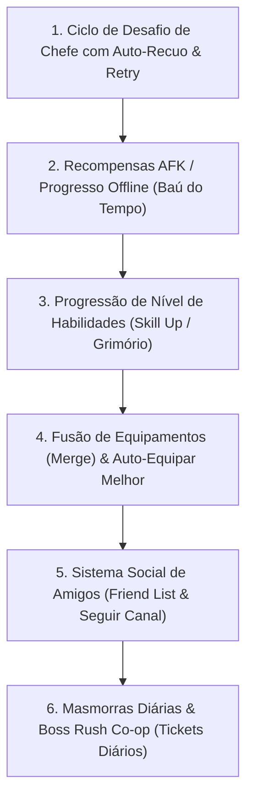

# 📜 MagicForge: Universe — Roadmap de Mecânicas Idle RPG & Registro de Progresso

> **Finalidade deste documento**: Servir como ponto único de verdade (Single Source of Truth) entre o usuário, Antigravity e Codex. Contém o que já foi entregue, o que está em andamento e a ordem exata das próximas mecânicas a serem implementadas. Se qualquer conversa for reiniciada ou compactada, este documento orienta a retomada imediata sem perda de contexto.

---

## 📌 Status Atual do Projeto
* **Data da Última Atualização**: 03/11/2026
* **Branch Principal**: `master` (100% sincronizado com `origin/master`)
* **Testes Automatizados**:
  - Servidor: 23/23 testes passando (100% autoritativo)
  - Cliente (Apresentação, Runic Layout & Party): 36/36 testes passando (100%)
  - Build de Produção do Cliente (`vite build`): 100% OK

---

## ✅ 1. O que JÁ foi Entregue e Validado (Histórico Consolidado)

1. **Arquitetura de Servidor Autoritativo 20Hz**:
   - Loop estável de 50ms por tick, compensação de drift e AOI (Spatial Grid 20x20m).
   - Persistência robusta no SQLite (`magicforge.db`) com transações seguras.
2. **Sistema de Classes & Combate D&D 5E**:
   - 4 Classes base (Guerreiro, Clérigo, Bárbaro, Arqueiro) com atributos primários D&D (STR, DEX, CON, INT, WIS, CHA).
   - 4 Slots táticos com 3 escolhas de skills por slot (Truque, Nv 1, Nv 2, Nv 3).
   - Mecânicas reais: Bleed com ticks de dano, Stun, Quebra de Armadura, Escudo com Reflexão, Avatar da Guerra e Imunidade.
3. **Economia, Itens e Forja**:
   - Mochila expansível autoritativamente de 20 até 100 slots (`C2S_EXPAND_INVENTORY`).
   - Refino de equipamentos de +1 até +15 (`C2S_REFINE_EQUIPMENT`).
   - Soquetes de gemas em armas e armaduras (`C2S_SOCKET_GEM`).
   - Álbum de Cartas de Monstros com coleção passiva e encaixe de cartas ativas (`C2S_EQUIP_CARD`).
   - Automação FarmHelper com auto-potions e auto-salvage em massa de itens comuns/incomuns.
4. **Mundos, Fases e Preservação**:
   - Fases 1 a 10 no Mundo 1 (Floresta da Forja) e Mundo 2 (Picos de Jotunheim).
   - Spawn de Grimgor (Boss Mundo 1) e Frostbite (Boss Mundo 2).
   - Portal Rúnico com **preservação integral de progresso** (nível, EXP, ouro, inventário, equipamentos, gemas, cartas, loadout e Reborn).
5. **Multiplayer, Canais & Grupos (Party)**:
   - `WorldManager`: balanceamento automático e canais instanciados (Canal 1 e Canal 2 para cada mundo).
   - `PartyManager`: grupos de 2 a 4 jogadores, sincronização de HP/MP/Nível em tempo real, liderança (promover/expulsar/sair/desfazer).
   - EXP Cooperativa: bônus de proximidade de +10% de EXP por membro aliado a até 25m.
   - UI Web: HUD de Grupo (`PartyHUD.ts`) e Seletor de Canais (`ChannelSelector.ts`).
6. **Apresentação Rúnica & UI Visual (Merge com `fix/telas-bordas-cards`)**:
   - Molduras rúnicas esculpidas, SVG assets customizados, gaveta tática responsiva, docking de poções e pedestal de seleção de heróis.

---

## 🧭 2. Ordem Sequencial das Novas Mecânicas Idle RPG

Esta é a ordem oficial de desenvolvimento para transformar o MagicForge em um Idle RPG de ponta (referência aos sucessos do *topidle.com* como *Legend of Slime*, *Blade Idle*, *AFK Arena* e *Slayer Legend*):

---

### ✅ ETAPA 1: Ciclo de Desafio de Chefe com Auto-Recuo & Retry *(CONCLUÍDO E VALIDADO)*
* **Problema resolvido**: Se o temporizador de 60s do Chefe expira ou o jogador morre na Fase 10, o jogo não pausa o farm nem trava a tela.
* **Comportamento Implementado e Testado**:
  1. **Auto-Recuo**: Falha na luta do Chefe (TIMEOUT ou DEATH) aciona recuo imediato para a **Fase 9**, onde monstros normais continuam spawnando e sendo abatidos automaticamente (ganho ininterrupto de Ouro e EXP). Jogadores mortos são revividos com 100% HP/MP no acampamento.
  2. **Botão de Re-desafio**: No HUD e na barra de fase, o botão **`[💀 DESAFIAR CHEFÃO (Fase 10)]`** fica disponível para acionamento manual imediato.
  3. **Toggle de Auto-Desafio (`autoChallengeBoss: ON/OFF`)**:
     - `OFF` (padrão): O jogador permanece no farm seguro da Fase 9 até decidir re-desafiar.
     - `ON`: Ao abater os monstros da Fase 9, o servidor re-desafia o Chefe e avança para a Fase 10 automaticamente.
  4. **Entrada na Arena do Chefe**: Ao desafiar, cura 100% de HP/MP, avança para a Fase 10, despawna monstros menores e invoca o Chefão do mundo com 60s no cronômetro.
* **Validação**: Testes automatizados em `server/tests/boss-challenge-cycle.test.ts` (4/4 passando).

---

### ⏳ ETAPA 2: Recompensas AFK / Progresso Offline (Baú do Tempo)
* **Objetivo**: Recompensar o jogador pelo tempo que passou fora do jogo (celular bloqueado ou navegador fechado).
* **Mecânica**:
  - Salvar `last_logout_timestamp` no SQLite.
  - Ao fazer login: calcular o tempo decorrido $\Delta t$ (limitado entre 5 minutos e 12 horas).
  - Fórmula de rendimento: $\text{Ouro Ganho} = \Delta t \times \text{Taxa de Ouro/min da Maior Fase Alcançada}$.
  - Modal estético de boas-vindas com botão de resgate `[Coletar Recompensas Offline]`.

---

### ⏳ ETAPA 3: Progressão de Nível de Habilidades (Skill Up)
* **Objetivo**: Permitir que habilidades ativas e truques evoluam além do nível base.
* **Mecânica**:
  - Cada habilidade no Grimório pode subir de Nível 1 a Nível 20.
  - Custo de upgrade em Ouro e Pergaminhos Arcanos.
  - Cada nível aumenta o multiplicador de dano (% de ATK) ou a quantidade de escudo/cura da magia.
  - Persistência na tabela `character_skills` do SQLite.

---

### ⏳ ETAPA 4: Fusão de Equipamentos (Merge) & Auto-Equipar Melhor
* **Objetivo**: Dar utilidade para dezenas de itens acumulados na bag e facilitar a troca de equipamentos no celular.
* **Mecânica**:
  - **Fusão**: Juntar 5 espadas comuns idênticas para forjar 1 espada incomum (+atributos).
  - **Auto-Equipar**: Botão no Paperdoll que compara o Poder de Combate (CP) de todos os itens do inventário com os equipados e substitui instantaneamente pelos mais fortes.

---

### ⏳ ETAPA 5: Sistema Social de Amigos (Friend List & Seguir Canal)
* **Objetivo**: Conectar jogadores sem depender apenas do chat global.
* **Mecânica**:
  - Enviar pedido de amizade por nome (`C2S_FRIEND_REQUEST`).
  - Aceitar/recusar pedidos pendentes (`C2S_FRIEND_RESPOND`).
  - Lista de Amigos com status Online/Offline, nível, classe e em qual canal o amigo está jogando.
  - Botão rápido: *"Seguir para o Canal do Amigo"* e *"Convidar Amigo para Grupo"*.

---

### ⏳ ETAPA 6: Masmorras Diárias & Boss Rush Co-op (Tickets Diários)
* **Objetivo**: Conteúdo endgame diário para jogar solo ou em grupo.
* **Mecânica**:
  - 3 Tickets Diários gratuitos que recarregam à meia-noite.
  - Masmorra de Ouro (Goblin Mineiro), Masmorra de Gemas (Gólem Rúnico) e Boss Rush.
  - Entrada em grupo com verificação de prontidão (*Ready Check*).

---

## 📝 Registro de Atualizações
| Data | Autor | Alteração Realizada |
| :--- | :--- | :--- |
| **03/11/2026** | Antigravity | Criação deste documento de arquitetura e backlog de mecânicas Idle RPG. |
| **03/11/2026** | Antigravity | Implementação do Sistema de Canais autoritativo e Grupos cooperativos (+10% EXP). |
| **03/11/2026** | Antigravity | Merge da branch visual `fix/telas-bordas-cards` e sincronização no GitHub `master`. |
